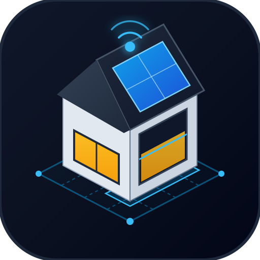

<div align="center">
  
  <h1>RealPlan 3D – Interaktiver 3D Smart-Home Grundriss & CAD-Architekturplaner</h1>
  <p><strong>Echtzeit-3D-Visualisierung, mehrstöckiger Haus- & Grundstücksplaner, Dach- & PV-Konfigurator sowie Live-Steuerung direkt in Home Assistant</strong></p>

  <p>
    <a href="https://github.com/hacs/integration"></a>
    <a href="https://www.home-assistant.io/"></a>
    
    
  </p>
</div>

---

## Inhaltsverzeichnis

1. [Überblick & Kernfunktionen](#-überblick--kernfunktionen)
2. [Neu in v4.4.2: Schaltschrank-Planer, Klima-/Zigbee-Sensorik, 3D-Raum-Mini-Cards & Outdoor-Küche](#-neu-in-v442-schaltschrank-planer-klima-zigbee-sensorik-3d-raum-mini-cards--outdoor-küche)
3. [Installation in Home Assistant (HACS & Manuell)](#-installation-in-home-assistant-hacs--manuell)
4. [Einrichtung als Seitenleisten-Panel & Lovelace-Karte](#-einrichtung-als-seitenleisten-panel--lovelace-karte)
5. [Ansichten, Kamera-Steuerung & Live-Dashboard](#-ansichten-kamera-steuerung--live-dashboard)
6. [2D-CAD-Grundriss-Editor & Mehrstöckige Gebäudeplanung](#-2d-cad-grundriss-editor--mehrstöckige-gebäudeplanung)
7. [Dach-Konfigurator, Gauben, Dachfenster & Photovoltaik (PV)](#-dach-konfigurator-gauben-dachfenster--photovoltaik-pv)
8. [Türen, Fenster (2-Sensor-Kipplogik), Rollläden & Garagentore](#-türen-fenster-2-sensor-kipplogik-rollläden--garagentore)
9. [Treppen-Baukasten (Innen- & Außentreppen inkl. KG ↔ EG)](#-treppen-baukasten-innen--außentreppen)
10. [3D-Pool-Baukasten, Pool-Technik, Outdoor-Küche & Außenanlagen](#-3d-pool-baukasten-freiform-sonnensegel--außenanlagen)
11. [Smart-Home-Entitäten, 3D-Status-Badges & Schwebende Raum-Mini-Cards](#-smart-home-entitäten-3d-status-badges--eigene-dashboard-cards)
12. [Backup, JSON-Export/Import & Persistenz](#-backup-json-exportimport--persistenz)

---

## Überblick & Kernfunktionen

**RealPlan 3D** verwandelt dein Home Assistant System in ein interaktives, architektonisch präzises **3D-Smart-Home-Kontrollzentrum** mit integriertem **2D-CAD- & 3D-Grundriss-Editor**. Anders als statische Bild-Overlays erzeugst du dein gesamtes Haus, Nebengebäude (Garage, Carport, Wintergarten, Anbau-Gewächshaus) und Grundstück direkt im Browser – inklusive Echtzeit-Synchronisation mit deinen Home Assistant Entitäten.

### Highlights auf einen Blick
- **Mehrstöckige Architektur (`KG`, `EG`, `1. OG`, `DG`)**: Beliebig viele Räume und separate Gebäude mit automatischer Wandverschmelzung (Seamless Wall-Carving) und bündigem 3D-Bodenplatten-/Sockelabschluss ohne Überstand.
- **Interaktiver Schaltschrank- & Hutschienen-Planer (DIN-Rail Konfigurator)**: Konfiguriere Haupt-Zählerschränke und Unterverteilungen (`1–6 Hutschienen-Reihen`, `1–3 Felder`, Rauchglas-/Stahlblechtür oder offen) und bestücke jede Hutschiene TE-genau mit FI-Schutzschaltern, LS-Automaten, Shelly Pro 3EM Smart-Metern, Hutschienen-Relais, Überspannungsschutz, 24V-Netzteilen und Zigbee-DIN-Gateways inkl. eigener `entity_id` pro Modul.
- **Erweiterte Klima-, Umwelt- & Funk-Sensorik**: Raum-Temperatur- & Luftfeuchtesensoren mit E-Ink-Display, wetterfeste IP65-Außenklimasensoren, Decken-Lux- & 360°-Präsenzmelder, Solar-Bodenfeuchtesensoren für den Garten sowie **Zigbee / Z-Wave / Thread PoE-Stabantennen** und **WLAN / BLE-Proxy Decken-Access-Points** mit einblendbarem 3D-Funkradius.
- **Schwebende 3D-Raum-Status-Mini-Cards**: Bei der automatischen Haus- & Raum-Tour oder beim Zoom auf einen Raum schwebt eine frei konfigurierbare Live-Status-Card (Temperatur, Luftfeuchte, Lichter, offene Fenster/Türen, Stromverbrauch & eigene Entitäten) direkt über dem Raum.
- **Blickrichtungsabhängige Wand-Absenkung (`Smart Camera Wall Cutaway`)**: Bei Kamerafahrten und Raumfokus werden automatisch nur die zur Kamera gewandten Vorderwände abgesenkt (inkl. Ausblendung von Wandlampen/Garderoben/Rauchmeldern auf diesen Wänden), während Rückwände sowie Fenster, Türen und Tore sichtbar bleiben.
- **Stufenloses `0°–360°` Drehen in 2D & 3D**: Jedes Objekt lässt sich über den grünen 2D-Rotations-Greifer per Drag & Drop oder per `0°–360°` Schieberegler und Grad-Direkteingabe frei im Raum drehen.
- **Echtzeit-Tageszeit & Nacht-Automatik für Straßenlaternen**: Straßen- und Parklaternen schalten sich im 3D-Modell nur bei Dämmerung und Nacht (`< 06:30 Uhr` oder `> 18:15 Uhr`) automatisch ein und bleiben tagsüber aus.

---

## Neu in v4.4.2: Schaltschrank-Planer, Klima-/Zigbee-Sensorik, 3D-Raum-Mini-Cards & Outdoor-Küche

### ⚡ 1. Interaktiver Schaltschrank- & Hutschienen-Planer (DIN-Rail Konfigurator)
Wählst du einen **Zählerschrank (`electrical_meter_cabinet`)** oder eine **Unterverteilung (`sub_distribution_board_1row` / `sub_distribution_board_3row`)** aus, öffnet sich im rechten Inspektor der **Schaltschrank- & Hutschienen-Planer**:
- **Gehäuse-Geometrie**: Wähle **1 bis 6 Hutschienen-Reihen**, **1 bis 3 Schrank-Felder**, ein optionales **eHZ-Zweirichtungszählerfeld** auf der linken Seite sowie die **Tür-Variante** (*🪟 Rauchglastür*, *🚪 Stahlblechtür* oder *🔓 Offen (3D)* für freien Blick auf die Hutschienen).
- **TE-genaue Hutschienen-Bestückung**: Bestücke jede einzelne Hutschiene per Klick oder über den Button **„⚡ Standard-Bestückung“** mit farbcodierten 3D-DIN-Rail-Modulen:
  - `FI` **FI-Schutzschalter (RCD 40A/30mA, 4 TE)** mit blauem Prüftaster
  - `B16` **LS-Automat 1-polig (B16 / C16, 1 TE)** & `3×B16` **3-poliger LS-Automat (3 TE)** für Herd, Wallbox & Wärmepumpe
  - `3EM` **3-Phasen Smart-Energy-Meter (Shelly Pro 3EM / Modbus, 4 TE)**
  - `Relais` **Hutschienen-Smart-Relais (Shelly Pro 1PM/2PM/4PM, 2 TE)**
  - `SPD` **Überspannungsschutz Typ 1+2 (4 TE)**, `24V` **Hutschienen-Netzteil (2 TE)**, `DIN-GW` **Zigbee/LAN Hutschienen-Gateway (2 TE)** und `KNX` **8-fach Schalt-/Jalousieaktor (4 TE)**
- **Individuelle Beschriftung & Home Assistant `entity_id` pro Modul**: Jedes Hutschienen-Modul kann im Planer beschriftet (z. B. *„WP Außengerät“*, *„Küche Herd“*) und mit einer eigenen Home Assistant Entität verknüpft werden.

### 🌡️ 2. Neue Temperatur-, Klima-, Bodenfeuchte- & Funk-Sensoren (Zigbee / Z-Wave / Thread)
Unter der Kategorie **Sensoren, Funk & Schalter** stehen 6 neue hochdetaillierte 3D-Sensoren und Funk-Gateways bereit:
- **Raum-Temperatur- & Luftfeuchtesensor mit E-Ink-Display (`temp_humidity_display_sensor`)**: Wand- oder Tisch-Hygrometer (Aqara / Shelly H&T / Sonoff Stil) für präzise Raumklima-Erfassung (`°C` & `% rF`).
- **Wetterfester Außen-Temperatur- & Klimasensor IP65 (`outdoor_temp_weather_sensor`)**: Fassaden-Klimasensor mit weißen Strahlungsschutzlamellen.
- **Decken-Helligkeits- & 360°-Präsenzmelder (`lux_motion_ceiling_sensor`)**: Kombinierter Lux-Lichtsensor und 360°-Decken-Präsenzmelder mit zuschaltbarem 3D-Erfassungskegel.
- **Bodenfeuchte- & Erdtemperatursensor (`soil_moisture_garden_sensor`)**: Solarbetriebene Funk-Erdsonde für Rasen, Hochbeet, Gewächshaus und automatische Gartenbewässerung.
- **Zigbee / Z-Wave / Thread Funk-Antenne PoE/USB (`zigbee_zwave_antenna_poe`)**: Langstrecken-Funk-Koordinator (z. B. SLZB-06 / Z-Wave 800 / Matter-over-Thread) mit High-Gain-Stabantenne und einblendbarer **3D-Funk-Abdeckungssphäre** (über den Button `Sensorkegel`).
- **WLAN / Thread / BLE Decken-Access-Point (`wifi_mesh_access_point_ceiling`)**: Decken-Mesh-Repeater & ESPHome Bluetooth-Proxy mit blauem LED-Ring und 3D-Funkkegel.

### 🪪 3. Schwebende 3D-Raum-Status-Mini-Cards (Tour & Raumfokus)
- Im rechten Raum-Inspektor unter **„🪪 3D-Raum-Status-Mini-Card (Tour & Zoom)“** wählst du für jeden Raum individuell aus, welche Live-Werte angezeigt werden sollen (*🌡️ Temperatur*, *💧 Luftfeuchtigkeit*, *💡 Eingeschaltete Lichter*, *🪟 Offene Fenster/Türen*, *⚡ Raum-Stromverbrauch in W* sowie beliebig viele **eigene Home Assistant Entitäten**).
- Sobald du in den Raum zoomst oder die automatische **Haus- & Raum-Tour** den Raum anfährt, schwebt die Glas-Mini-Card direkt im 3D-Raum.

### 🍖 4. Modulare Outdoor-Küche, Pool-Technik & Geschossübergreifende Keller-Außentreppe
- **Outdoor-Küche**: Edelstahl-Gasgrill-Station (`outdoor_kitchen_bbq_station`), Outdoor-Spül- & Getränkekühlschrank-Modul (`outdoor_kitchen_sink_fridge`), Holz-Pizzaofen (`outdoor_kitchen_pizza_oven`) und L-Ecktheke (`outdoor_kitchen_corner_island`).
- **Pool-Technik**: Sandfilteranlage mit Umwälzpumpe (`pool_sand_filter_pump`), pH-/Chlor-Salzelektrolyse-Dosieranlage (`pool_dosing_control_unit`) und Inverter-Pool-Wärmepumpe (`pool_heat_pump`).
- **Keller-Außentreppe (`KG ↔ EG`)**: Eine im Keller (`KG`) gesetzte Keller-Außentreppe (`outdoor_stairs_kellertreppe`) ragt automatisch bis ins Erdgeschoss (`EG`), ist im EG in **2D** und **3D** sichtbar und schneidet das Gelände sauber aus.
- **Bedarfsweise Entitäts-Erzeugung**: Über den Schalter **„⚡ Auto-Entität“** im Objektkatalog bestimmst du selbst, ob beim Platzieren neuer Geräte automatisch eine Demo-Entität angelegt wird, und im Live-Cockpit siehst du unter **„Im 3D-Plan“** nur Geräte, die du tatsächlich in deinem Haus verbaut hast.

---

## Installation in Home Assistant (HACS & Manuell)

### Option A: 1-Klick-Installation über HACS (Empfohlen)

1. Klicke auf den Button, um das Repository direkt in deinem Home Assistant HACS zu öffnen:

   [](https://my.home-assistant.io/redirect/hacs_repository/?owner=tarik19903&repository=RealPlan3d&category=integration)

2. Alternativ manuell in HACS hinzufügen:
   - Öffne **HACS** in deiner Home Assistant Seitenleiste.
   - Klicke oben rechts auf das **Drei-Punkte-Menü (`⋮`) → Benutzerdefinierte Repositories**.
   - Trage als Repository-URL `https://github.com/tarik19903/RealPlan3d` ein und wähle als Kategorie **Integration** (bzw. *Dashboard*).
   - Suche nach **RealPlan 3D**, klicke auf **Herunterladen** und starte **Home Assistant neu**.

### Option B: Manuelle Installation

1. Lade das neueste Release dieses Repositories herunter.
2. Kopiere den Ordner `custom_components/realplan3d` in das Verzeichnis `<config>/custom_components/realplan3d` deiner Home Assistant Installation.
3. Starte Home Assistant neu.

### Ordnerstruktur des Marken-Logos (`brand/`)
Ab Home Assistant 2024.3+ und im HACS Store wird das offizielle **RealPlan 3D Logo** automatisch aus dem Verzeichnis `custom_components/realplan3d/brand/` (`icon.png`, `icon@2x.png`, `logo.png`, `logo@2x.png`, `logo.svg`) geladen und in der Integrationsübersicht sowie in HACS angezeigt.

---

## Einrichtung als Seitenleisten-Panel & Lovelace-Karte

### 1. Integration aktivieren (Seitenleisten-Panel)
1. Gehe in Home Assistant auf **Einstellungen → Geräte & Dienste**.
2. Klicke unten rechts auf **+ Integration hinzufügen** und suche nach **RealPlan 3D**.
3. Nach dem Hinzufügen erscheint **RealPlan 3D** automatisch als eigenes Vollbild-Panel in deiner linken Home Assistant Seitenleiste.

### 2. Einbindung als Lovelace-Dashboard-Karte
Die benutzerdefinierte Karte `custom:realplan3d-card` wird automatisch bei den Frontend-Ressourcen registriert. Du kannst sie auf jedem bestehenden Dashboard hinzufügen:

```yaml
type: custom:realplan3d-card
```

---

## Ansichten, Kamera-Steuerung & Live-Dashboard

Oben in der Haupt-Werkzeugleiste wechselst du nahtlos zwischen drei Arbeitsmodi:

| Modus | Beschreibung |
| :--- | :--- |
| **Live-Ansicht** | Reiner Smart-Home-Steuerungs- & Überwachungsmodus ohne versehentliches Verschieben von Möbeln oder Wänden. |
| **3D-Editor** | Interaktives Platzieren, Verschieben, Drehen und Konfigurieren von Möbeln, Türen, Fenstern, Lichtern und Außenobjekten direkt in der 3D-Szene. |
| **2D-Grundriss** | Präziser CAD-Grundriss-Editor mit Maßlinien, Fangraster (Snap-Grid), Wand-Zeichenwerkzeug und ziehbaren Polygon-Eckpunkten. |

### Kamera-Steuerung in 3D
- **Drehen (Orbit)**: Linke Maustaste gedrückt halten & bewegen (oder 1-Finger-Touch).
- **Verschieben (Pan)**: Rechte Maustaste (oder `Shift` + Linke Maustaste / 2-Finger-Touch) bewegen.
- **Zoomen**: Mausrad scrollen oder Pinch-Geste.
- **Schnell-Kamerawinkel**: Wechsel zwischen *Isometrie*, *Vogelperspektive (Top-Down)*, *Süd-Ansicht* und *West-Ansicht*.
- **Reiner Innenraum-Fokus**: Über das Dropdown **Raum-Fokus** in der oberen Leiste werden ausschließlich echte Innenräume aufgelistet (Außenflächen wie Rasen, Straße oder Bürgersteig werden automatisch ausgefiltert). Ein Klick fährt die Kamera direkt auf den gewünschten Raum.

### Umgebung, Echtzeit-Uhrzeit & Wetter
- **Echtzeit-Tageszeit (`Echtzeit`-Button)**: Synchronisiert den Sonnen- und Mondstand sowie die Himmelsbeleuchtung sekundengenau mit der aktuellen lokalen Uhrzeit. Alternativ kannst du den Zeit-Schieberegler manuell zwischen `00:00` und `23:59` Uhr bewegen.
- **Automatische Nachtbeleuchtung**: Bei Dämmerung und Nacht (`< 06:30` Uhr oder `> 19:30` Uhr) schalten sich Straßenlaternen entlang der Straße automatisch ein. Garten-Pollerleuchten und klassische 3-flammige Parkleuchten leuchten nachts automatisch, **sofern ihnen keine eigene Home Assistant Entität zugewiesen wurde** (mit Entität folgen sie strikt dem echten Home Assistant Status).
- **Wetter-Simulation**: Umschaltbar zwischen *Klar*, *Regen* (mit animierten Regentropfen und nassen Oberflächen) und *Schnee* (mit Schneeflocken und winterlicher Atmosphäre) – oder automatisch gekoppelt an deine `weather.*`-Entität.
- **Render-Qualität**: Wähle zwischen **Eco** (für Tablets/Wandpanels mit geringerer GPU-Last), **Ausgewogen** und **Ultra** (weiche Schatten, hochauflösende Reflexionen und Kantenglättung).
- **Wand-Cutaway & Thermo-Heatmap**:
  - **Wand-Schnitt (Cutaway)**: Blendet Außenwände auf der der Kamera zugewandten Seite automatisch halbhoch ab, damit du ungehindert in die Räume blickst.
  - **Wärmebild-Heatmap**: Färbt alle Räume dynamisch anhand ihrer verknüpften Temperatursensoren (`sensor.*_temperature` oder `climate.*`) von Blau (kühl) über Grün (Komfort) bis Rot (warm) ein.

### Haus- & Raum-Tour sowie Ereignis-Kamera
- **Haus- & Raum-Tour (`Tour`)**: Fährt in ruhigem Tempo (ca. 10,5 Sekunden pro Station) nacheinander durch alle Innenräume sowie zu Panorama-Außenansichten.
  - **Freier Raumblick während der Tour**: Selbst wenn Dächer fest eingeblendet sind, werden Dächer sowie im Sichtweg liegende Türen und Fenster während eines Innenraum-Stopps automatisch ausgeblendet, damit der Blick ins Zimmer niemals verdeckt wird.
- **Auto-Sprung bei Ereignissen**: Ist der Ereignis-Fokus aktiviert, springt die Kamera im Live-Modus automatisch zu Objekten, deren Zustand sich kritisch ändert (z. B. Garagentor öffnet sich, Haustür wird entriegelt, Fenster wird geöffnet oder Rauch-/Wassermelder schlägt an).

---

## 2D-CAD-Grundriss-Editor & Mehrstöckige Gebäudeplanung

Im Modus **2D-Grundriss** konstruierst du deine Stockwerke (`KG`, `EG`, `1. OG`, `DG`) maßstabsgetreu:

### 1. Räume & Freiform-Polygone zeichnen
- **Rechteck-Raum**: Einfach Breite, Tiefe und Wandstärke festlegen oder per Drag & Drop aufziehen.
- **Freiform-Polygon (L-Form, U-Form, Erker, Schrägwände)**:
  - Zeichne Punkt für Punkt im 2D-Canvas oder füge auf jedem Wandabschnitt über das **`+`-Mittelpunkt-Symbol** neue Eckpunkte ein.
  - Alle Eckpunkte lassen sich jederzeit frei mit der Maus ziehen; benachbarte Raumwände **snappen exakt aufeinander** und verschmelzen in der 3D-Ansicht zu einer durchgehenden Wand ohne Lücken.
- **Bodenmaterialien & Wandfarben**:
  - Wähle pro Raum aus Materialien wie *Eichenparkett, Fischgrät-Parkett, Schiefer-Fliesen, Marmor, Beton-Estrich, Teppich, Terrassendielen, Hofpflaster, Asphalt, Kies, Gartenrasen, Blumenbeet, Rindenmulch* oder *Sandkasten*.
  - Bestimme Innenwandfarbe, Außenfassadenfarbe (Giebeldreiecke übernehmen automatisch exakt die gewählte Fassadenfarbe des Gebäudes) sowie individuelle Wandhöhen und Sockelhöhen.

### 2. Gebäude-Gruppierung & Vorlagen
- **Gebäude-Zuweisung (`buildingId`)**: Jeder Raum kann einem Gebäude zugeordnet werden (z. B. `Haupthaus`, `Garage`, `Gartenhaus`). Dadurch erhält jedes Gebäude sein eigenes, unabhängiges Dach und lässt sich als Einheit drehen.
- **Fertige Gebäude-Vorlagen**: Füge mit einem Klick komplette Grundrisse ein (*Einfamilienhaus, Winkelbungalow, Doppelgarage, Wintergarten/Anbau*).
- **Freie Trennwände & Raumteiler**: Zeichne zusätzliche Innenwände als *Vollwand*, *Halbhohe Brüstungswand (1,20 m)* oder *Wanddurchbruch / Torbogen*.
- **Hintergrund-Bauplan (Blueprint-Overlay)**: Lade deinen originalen Architekten-Grundriss als Bilddatei hoch, passe Transparenz, Position und Maßstab (Meter-Kalibrierung) an und zeichne die Wände direkt darüber nach.
- **Sperr-Funktion (`🔒`)**: Einzelne Räume oder alle Räume lassen sich gegen versehentliches Verschieben sperren.

---

## Dach-Konfigurator, Gauben, Dachfenster & Photovoltaik (PV)

Über den **Dach-Konfigurator** im rechten Eigenschaften-Panel erhält jedes Gebäude (`buildingId`) ein maßgeschneidertes Dach:

### 1. Unterstützte Dachformen (6 Typen)
1. **Satteldach (`pitched`)** – Klassisches Giebeldach mit einstellbarer Firstausrichtung (Ost-West / Nord-Süd / Auto) und Giebelwänden in Fassadenfarbe.
2. **Walmdach (`hipped`)** – Allseitig geneigte Dachflächen mit Gratsparren.
3. **Krüppelwalmdach (`half_hipped`)** – Satteldach mit abgeschrägten oberen Giebelspitzen.
4. **Mansarddach (`mansard`)** – Gebrochene Dachfläche mit steilem Unterdach und flacherem Oberdach für maximalen Raum im Dachgeschoss.
5. **Pultdach (`pent`)** – Einseitig geneigte Dachfläche (ideal für moderne Neubauten, Anbauten oder Carports).
6. **Flachdach (`flat`)** – Mit umlaufender Attika, Kies-/Bitumenoptik oder Begrünung.

### 2. Separate Dach-Sichtbarkeit pro Gebäude
Du kannst **für jedes Gebäude separat** im Dach-Konfigurator festlegen, wann das Dach in 3D sichtbar ist:
- **Immer sichtbar (`always`)**: Ideal für Nebengebäude wie **Garage, Carport oder Gartenhaus**, deren Dach auch dann sichtbar bleiben soll, wenn du im Wohnhaus das Erdgeschoss betrachtest.
- **Automatisch / Nur im obersten Stockwerk (`top_floor` / `auto`)**: Blendet das Dach beim Bearbeiten unterer Etagen automatisch aus.
- **Ausgeblendet (`never`)**: Dauerhaft freier Blick von oben.

### 3. Dachgauben, Dachfenster & Schornstein
- **Mehrfach-Dachgauben**: Füge beliebig viele Gauben auf Vorder-, Rück-, Links- oder Rechtsseite hinzu.
  - **6 Gaubenformen**: *Schleppgaube, Spitzgaube/Satteldachgaube, Walmgaube, Flachdachgaube, Fledermausgaube (geschwungen)* und *Rundgaube*.
  - **1 bis 4 Fenster pro Gaube**: Jedes Gaubenfenster besitzt auf Wunsch eine **eigene Fenster-Sensor-Entität** (Geschlossen / Gekippt / Offen) sowie eine **eigene Rollladen-Entität (`cover.*`)**.
- **Dachfenster (Velux-Stil)**: Frei auf den Dachschrägen positionierbar, ebenfalls mit Öffnungs-/Kippstatus und Verdunkelungsrollo.
- **Schornstein / Kaminzug**: Frei positionierbar auf dem Dach mit Klinker-/Putzoptik und optionalem Kaminrauch bei aktivem Kamin.

### 4. Photovoltaik-Anlagen (PV-Module)
RealPlan 3D bietet **zwei kombinierbare Wege**, um PV-Module zu planen:
1. **Direkt im Dach-Konfigurator**:
   - Wähle die belegten Dachseiten (*Süd/Vorne, Nord/Hinten, Ost, West, Beidseitig* oder *Alle Seiten*).
   - **Exakte Modulanzahl eingeben (`moduleCount`, 1–60 Module)**: Gib z. B. exakt `18 Module` ein – der Dach-Builder verteilt genau 18 Solarmodule symmetrisch auf den gewählten Dachflächen. Alternativ kannst du über den prozentualen Flächenregler arbeiten.
   - Verknüpfe deine Wechselrichter-Entität (z. B. `sensor.pv_power`), um die aktuelle Erzeugungsleistung in Watt/kW direkt am Dach anzuzeigen.
2. **Frei platzierbares PV-Solarmodul-Feld (`solar_panel_array`)**:
   - Füge aus dem Katalog unter *Dach, Solar & Technik* ein **PV-Solarmodul-Feld** hinzu und verschiebe/drehe es frei auf Schrägdächern, Flachdächern (mit Aufständerung), Garagendächern oder im Garten.
   - Im Inspektor kannst du die **exakte Anzahl der PV-Module (`pvModuleCount`, 1–60)** sowie den **Aufständerungs-/Neigungswinkel (`0°–60°`)** stufenlos einstellen. Auf Gebäudegrundrissen rastet das Modulfeld automatisch auf der jeweiligen Dachhöhe ein.

---

## Türen, Fenster (2-Sensor-Kipplogik), Rollläden & Garagentore

### 1. Türen & Fenster mit 2-Sensor-Logik
Alle Türen und Fenster schneiden automatisch echte Öffnungen in die 3D-Wände (Wall-Cutouts) und bieten umfangreiche Architektur-Optionen:
- **Anschlagseite (`hingeSide`)**: Links (`L`) oder Rechts (`R`).
- **Öffnungsrichtung (`swingDirection`)**: Nach Innen (`inward`) oder nach Außen (`outward`).
- **Fenster-Stile**: *Einzelfenster, Doppelflügel-Fenster, Bodentiefes Fenster, Panoramafenster, Hebe-Schiebetür, Sprossenfenster (Landhaus), Rundbogenfenster, Lichtband (Keller/Garage)* und *Bullauge*.
- **2-Sensor-Kipplogik für Fenster**:
  - **Sensor 1 (Geöffnet / Griff unten-waagerecht)**: Öffnet den Fensterflügel um 65° in den Raum.
  - **Sensor 2 (Gekippt / Kipp-Kontakt)**: Kippt den Fensterflügel am oberen Spalt realistisch um 14° an (und färbt das Status-Badge gelb/orange statt rot).
  - Unterstützt selbstverständlich auch kombinierte Sensoren mit den Zuständen `closed`, `tilted` / `gekippt` und `open`.
- **Animierte Rollläden & Raffstores (`shutterEntityId`)**:
  - Verknüpfe eine `cover.*`-Entität oder teste den Schließgrad direkt per Schieberegler (`0 %` offen bis `100 %` geschlossen) mit sichtbaren Aluminium-Lamellen und Führungsschienen.

### 2. Garagentore & Einfahrtstore (6 Bauformen)
Alle Garagentore schließen im geschlossenen Zustand (`0 %`) **100 % bündig und lichtdicht** mit dem Torsturz und dem Boden ab. Im Eigenschaften-Panel kannst du jederzeit zwischen **6 detaillierten Tor-Bauformen** wechseln:
1. **Sektionaltor (Großlamelle, Anthrazit/Weiß)**: Klassisches Lamellentor, das beim Öffnen über gebogene Deckenlaufschienen unter die Garagendecke fährt.
2. **Holz-Sektionaltor (Eiche / Naturholz)**: Warme Holzlamellen-Optik mit Deckenlaufschienen.
3. **Panorama-Sektionaltor (Alu & Glas)**: Moderne Aluminium-Rahmenkonstruktion mit getönten Acrylglas-Sichtfeldern.
4. **Klassisches Schwingtor / Kipptor (`up_and_over_classic`)**: Einteiliges Torblatt mit vertikaler Sickenprägung und seitlichen Hebelarmen, das beim Öffnen im Bogen nach vorne/oben unter die Decke schwingt.
5. **Motorisiertes Lamellen-Rolltor (`roller_shutter_gate`)**: Feinprofilierter Aluminium-Rollpanzer, der sich platzsparend in einen kompakten Sturz-Rollkasten aufwickelt.
6. **Zweiflügeliges Scheunen- / Flügeltor (`double_wing_gate`)**: Zwei symmetrische Torflügel mit Kreuzstreben, oberen Sichtfenstern und Drückergarnitur, die um 95° nach außen aufschwingen.

Zusätzlich stehen für die Grundstückseinfahrt das **Elektrische Hof-Schiebetor (`sliding_driveway_gate`)** sowie das **Zweiflügelige Schmiedeeisen-Einfahrtstor (`double_swing_driveway_gate`)** mit Pfeilern und Warnblinklicht zur Verfügung.

---

## Treppen-Baukasten (Innen- & Außentreppen)

Beim Auswählen einer **Innentreppe** oder **Außentreppe** öffnet sich im rechten Panel der **Treppen-Konfigurator**:

### 1. Innentreppen (13 Bauformen inkl. S- & C-Wendelung)
- **Gerade Läufe & Podesttreppen**:
  - `straight` (Gerade Treppe), `l_landing_left` / `l_landing_right` (90° L-Podesttreppe), `u_turn` (180° U-Podesttreppe), `t_shape` (Repräsentative T-Podesttreppe).
- **Gewendelte Treppen (ohne Zwischenpodest, mit verzogenen Stufen)**:
  - `winder_l_left` / `winder_l_right`: 1/4 gewendelte Treppe (90° Links/Rechts).
  - `winder_u`: 2/4 gewendelte Treppe (180° Gegenlauf).
  - **2/4 S-Schwung (`winder_s_same_dir`)**: Unten 90° Antritt und oben 90° Austritt – **beide Enden schauen exakt in dieselbe Blickrichtung** (S-Verlauf).
  - **2/4 C-Schwung (`winder_c_same_side`)**: Unten und oben jeweils ein Viertel zur gleichen Raumseite gewendelt.
- **Spezialtreppen**:
  - `spiral` (Spindeltreppe / Wendeltreppe rund), `curved_arc` (Frei geschwungene Bogentreppe), `floating_cantilever` (Schwebende Kragarmtreppe an der Wand).
- **Detail-Optionen**: Stufenanzahl (`8–22`), Geschosshöhe, Laufbreite, Setzstufen (*Geschlossen* oder *Offen*), Unterbau (*Holzwangen, Mittelholm, Vollbeton, Schwebend*), Geländer (*Ganzglas, Edelstahl-Stäbe, Holz-Klassik, Industriestahl*), Stufenmaterial sowie **automatischer Deckendurchbruch (Deckenöffnung)** für das darüberliegende Stockwerk.

### 2. Außentreppen (8 Bauformen)
- *Gerade Freitreppe, L-Winkel-Außentreppe (Links/Rechts), Kellerabgang mit seitlichen Stützwänden (`basement_well`), Freistehende Stahltreppe mit Gitterroststufen, Halbrund-Eingangspodest (3 Seiten), Terrassen-Breitstufen* und *Garten-Hangtreppe aus Naturstein-Blockstufen*.

---

## 3D-Pool-Baukasten, Freiform-Sonnensegel & Außenanlagen

### 1. 3D-Pool-Baukasten (`swimming_pool`)
Wähle deinen Pool aus und passe jedes Detail live an:
- **Pool-Formen**: *Klassisch Rechteckig, Römischer Pool (mit halbrundem Einstieg), L-Form (Schwimmer + Lounge-Zone), Freiform / Nierenform* oder *Infinity-Überlaufpool*.
- **Maße & Tiefe**: Länge (`3–18 m`), Breite (`2–10 m`), Wassertiefe (`0,8–2,5 m`) und Beckenrand-Breite.
- **Folien-/Wasserfarbe**: *Karibik-Türkis, Azurblau, Sandstein/Lagune (Hellgrün-Türkis), Anthrazit/Schiefer-Steingrau* oder *Nachtblau/Tiefsee*.
- **Einbauteile**: Integrierte **Römische Einstiegstreppe / Sitzbank**, **Edelstahl-Poolleiter**, **Schwalldusche (Wasserfall-Schwanenhals)**, **elektrische Solar-Rollladenabdeckung (`cover.*` oder `0–100 %` Regler)** sowie **Unterwasser-LED-Scheinwerfer** und **Wassertemperatur-Sensoranzeige**.

### 2. Frei planbares Sonnensegel (`sun_shade_sail`)
Das Sonnensegel lässt sich flexibel an jede Terrasse und jeden Garten anpassen:
- **3 Bauform-Presets**:
  - **Viereck-Segel (4 Masten, konkav gespannt)**
  - **Dreieck-Segel (3 Masten)**
  - **Wand-Trapez (2 Hauswand-Wandanker + 2 freistehende Edelstahlmasten)**
- **Individuelle Maße & Farben**: Breite (`2,0–12,0 m`), Tiefe (`2,0–12,0 m`), Masthöhe (`2,0–4,5 m`) und Tuchfarbe (*Cremeweiß, Sonnengelb, Anthrazit, Terracotta, Sandbeige, Salbeigrün, Ozeanblau*).
- **Freies Ziehen der Eckmasten im 2D-Grundriss**: Sobald du das Sonnensegel im 2D-Grundriss auswählst, erscheinen an allen Ecken **orangefarbene Mast-Ziehpunkte**, mit denen du jeden einzelnen Mast- oder Wandbefestigungspunkt millimetergenau an deine Terrassenform anpassen kannst.

### 3. Gewächshäuser (Freistehend & Anbau an Garage/Wand)
- **Freistehendes Glas-Gewächshaus (`garden_greenhouse`)**: Mit Satteldach, Dachfenstern und Pflanzenbeeten.
- **Anbau-Gewächshaus an Wand/Garage (`lean_to_greenhouse_garage`)**: Speziell für den direkten Wandanschluss an eine Garage oder Hausfassade konzipiert – mit anthrazitfarbenem Aluminiumrahmen, halbtransparenten **Doppelstegplatten (Polycarbonat)**, niedrigem Backstein-/Klinkersockel, Pult-/trapezförmigem Dach mit Aufstellfenstern und angelehnter Aluminiumleiter.

### 4. Außen-Sitzgruppen, Parkleuchten & Zäune
- **Außen-Sitzgruppen (Kategorie Außenbereich)**:
  - **Polyrattan Eck-Loungeset (`rattan_corner_lounge_set`)** mit Sitzpolstern, Kissen und Glas-Couchtisch.
  - **Garten-Essgruppe 6 Personen (`garden_dining_set_6`)** mit großem Teakholztisch, 6 Armlehnstühlen, Sitzauflagen und aufgespanntem Marktschirm.
  - **Bistro-Sitzgruppe 2 Personen (`bistro_round_set_2`)** für Balkon, Vorgarten oder kleine Terrassen.
  - **Bierzeltgarnitur (`beer_garden_table_set`)** mit Festzelt-Holztisch und zwei Sitzbänken.
- **Klassische Außenbeleuchtung**:
  - **3-flammige Park-Kandelaberleuchte (`park_lamp_classic_3flame`)** im historischen Gusseisen-Stil mit drei warmweißen Laternenköpfen.
  - **Passende Klassische Wandlaterne (`wall_lantern_classic_park`)** mit geschwungenem Schmiedeeisen-Wandarm zur Fassadenmontage.
- **Ziehbare Zäune, Hecken & Wege**: Doppelstabmattenzaun, Holzzaun, Thuja-/Kirschlorbeerhecke, Gabionenwand, Pflasterweg, Einfahrt und Straße besitzen im 2D-Plan **Start- und End-Ziehpunkte (`A` → `B`)**, sodass du sie in beliebiger Länge und jedem Winkel entlang deiner Grundstücksgrenze spannen kannst.

---

## Smart-Home-Entitäten, 3D-Status-Badges & Eigene Dashboard-Cards

### 1. Entität zuweisen & Rolle festlegen (Sensor / Aktor / Beides)
Wähle im **3D-Editor** oder **2D-Grundriss** ein beliebiges Objekt aus und verknüpfe es im rechten Panel mit einer Home Assistant `entity_id` (mit Live-Suchfeld und Autovervollständigung):
- **Rollen-Modus (`interactionRole`)**:
  - **Aktor & Sensor (`both`)**: Zeigt den Live-Zustand an und lässt sich per Klick in der 3D-Ansicht direkt schalten/steuern.
  - **Nur Sensor (`sensor_only`)**: Reines Anzeige-Element (z. B. Tür-/Fensterkontakt, Temperatur, PV-Leistung) – verhindert versehentliches Schalten im Live-Modus.
  - **Nur Aktor (`actuator_only`)**: Reiner Schaltbefehl bei Klick.
- **3D-Status-Badge Sichtbarkeit (`badgeDisplayMode`)**:
  - *Immer einblenden*, *Nur wenn aktiv/offen* (ideal für offene Fenster oder offenes Garagentor), *Nur bei Hover/Auswahl* oder *Ausgeblendet*.

### 2. Eigene Dashboard-Cards im Live-3D-Overlay
Im **Live-Ansicht**-Modus kannst du dir eigene **Quick-Cards (Dashboard-Karten)** zusammenstellen:
- Zeigt aktive Ereignisse (z. B. *Garagentor offen*, *Fenster gekippt*, *Lichter eingeschaltet*), Raumklima-Werte, PV-Leistung oder Kamerastreams übersichtlich am Bildschirmrand.
- Ein Klick auf den Kamera-Button einer Card schwenkt die 3D-Kamera sofort zum jeweiligen Objekt im Haus.

### 3. Unterstützte Home Assistant Domains
| Domain | 3D-Effekt & Interaktion |
| :--- | :--- |
| `light.*` | Echte 3D-Punkt-/Spotlichtquelle (`THREE.PointLight`), Helligkeits- & RGB-Farbübernahme, Klick zum Ein-/Ausschalten. |
| `switch.*` / `input_boolean.*` | Schaltet zugewiesene Geräte, Steckdosen oder Beleuchtungsgruppen live um. |
| `binary_sensor.*` | Animiert Türen, Fenster (Offen / Gekippt), Garagentore, Bewegungsmelder, Rauch- & Wassermelder. |
| `cover.*` | Steuert Garagentore (`0–100 %`), Fenster-Rollläden, Pool-Abdeckungen und Einfahrtstore stufenlos. |
| `climate.*` / `sensor.*` | Zeigt Live-Temperatur, Luftfeuchtigkeit oder Leistung (W/kW) als 3D-Badge und speist die Raum-Heatmap. |
| `lock.*` | Visualisiert den Verriegelungsstatus an Haus- und Nebeneingangstüren und erlaubt Ent-/Verriegeln. |
| `camera.*` | Öffnet bei Klick auf eine 3D-Überwachungskamera oder Video-Türklingel das Live-Kamerabild im Overlay. |
| `media_player.*` | Lässt Smart-TVs und Lautsprecher im Betrieb aufleuchten und zeigt den Wiedergabestatus. |
| `vacuum.*` / `lawn_mower.*` | Zeigt Saugroboter und Mähroboter mit Status-Indikator im Raum bzw. auf dem Gartenrasen. |

---

## Backup, JSON-Export/Import & Persistenz

- **Automatische Speicherung in Home Assistant**: Im gekoppelten Home Assistant Betrieb wird dein kompletter 3D-Grundriss zentral im Home Assistant Storage persistiert, sodass er auf **allen Endgeräten** (PC, Wand-Tablet, Smartphone) sofort identisch zur Verfügung steht.
- **JSON-Projekt-Backup (`Export` / `Import`)**: Über die obere Werkzeugleiste kannst du deinen gesamten Grundriss (inkl. aller Stockwerke, Dach-/PV-Konfigurationen, Entitäts-Zuweisungen und eigenen Dashboard-Cards) jederzeit als `.json`-Datei exportieren und wieder importieren.

---

## Entwicklung & Lokaler Build

Falls du Änderungen am Frontend-Code vornimmst, kannst du das Paket wie folgt kompilieren und in die Home Assistant Custom Component übernehmen:

```bash
npm install
npm run build
cp -r dist/* custom_components/realplan3d/frontend/app/
```

---

<div align="center">
  <sub>Entwickelt für Home Assistant & HACS • RealPlan 3D Architektur- & Smart-Home-Visualisierung</sub>
</div>
