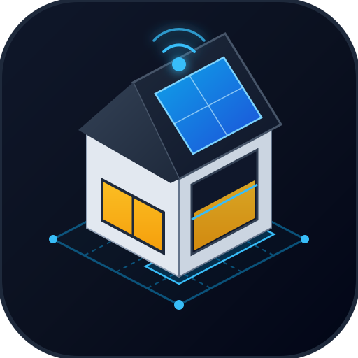

<div align="center">
  
  <h1>RealPlan 3D – Interaktiver 3D Smart-Home Grundriss & CAD-Architekturplaner</h1>
  <p><strong>Echtzeit-3D-Visualisierung, mehrstöckiger Haus- & Grundstücksplaner, Dach- & PV-Konfigurator sowie Live-Steuerung direkt in Home Assistant</strong></p>

  <p>
    <a href="https://github.com/hacs/integration"></a>
    <a href="https://www.home-assistant.io/"></a>
    
    
  </p>
</div>

---

## Inhaltsverzeichnis

1. [Überblick & Kernfunktionen](#-überblick--kernfunktionen)
2. [Neu in v4.8.0: Einzel-Deckenspots, Freie Gruppierung, Elektro & FRITZ! im Wandplaner, 3D-Elektroleitungen & Live-Energiefluss](#-neu-in-v480-einzel-deckenspots-freie-gruppierung-elektro--fritz-im-wandplaner-3d-elektroleitungen--live-energiefluss)
3. [Neu in v4.7.0: Kamerafahrt-Routenplaner, Saugroboter-Raumfahrt, Haustiere, Audio-Geräte, Decken-LED-Dachclipping & Saisonale Themes](#-neu-in-v470-kamerafahrt-routenplaner-saugroboter-raumfahrt-haustiere-audio-geräte-decken-led-dachclipping--saisonale-themes)
4. [Neu in v4.6.0: Frei konfigurierbare 3D-Raum-Cards, 3D-Cards-Zentrale, Explosionsansicht & 100 % echte HA-Entitäten](#-neu-in-v460-frei-konfigurierbare-3d-raum-cards-3d-cards-zentrale-explosionsansicht--100--echte-ha-entitäten)
5. [Neu in v4.4+: Schaltschrank-Planer, Klima-/Zigbee-Sensorik & Outdoor-Küche](#-neu-in-v44-schaltschrank-planer-klima-zigbee-sensorik--outdoor-küche)
6. [Installation in Home Assistant (HACS & Manuell)](#-installation-in-home-assistant-hacs--manuell)
7. [Einrichtung als Seitenleisten-Panel & Lovelace-Karte](#-einrichtung-als-seitenleisten-panel--lovelace-karte)
8. [Ansichten, Kamera-Steuerung & Live-Dashboard](#-ansichten-kamera-steuerung--live-dashboard)
9. [2D-CAD-Grundriss-Editor & Mehrstöckige Gebäudeplanung](#-2d-cad-grundriss-editor--mehrstöckige-gebäudeplanung)
10. [Dach-Konfigurator, Gauben, Dachfenster & Photovoltaik (PV)](#-dach-konfigurator-gauben-dachfenster--photovoltaik-pv)
11. [Türen, Fenster (2-Sensor-Kipplogik), Rollläden & Garagentore](#-türen-fenster-2-sensor-kipplogik-rollläden--garagentore)
12. [Treppen-Baukasten (Innen- & Außentreppen inkl. KG ↔ EG)](#-treppen-baukasten-innen--außentreppen)
13. [3D-Pool-Baukasten, Pool-Technik, Outdoor-Küche & Außenanlagen](#-3d-pool-baukasten-freiform-sonnensegel--außenanlagen)
14. [Smart-Home-Entitäten, 3D-Status-Badges & Schwebende Raum-Mini-Cards](#-smart-home-entitäten-3d-status-badges--eigene-dashboard-cards)
15. [Schritt-für-Schritt-Anleitung: Vom leeren Plan zum fertigen 3D-Smart-Home](#-schritt-für-schritt-anleitung-vom-leeren-plan-zum-fertigen-3d-smart-home)
16. [Praxis-Beispiele & Konfigurations-Rezepte (Best Practices)](#-praxis-beispiele--konfigurations-rezepte-best-practices)
17. [Backup, JSON-Export/Import & Persistenz](#-backup-json-exportimport--persistenz)

---

## Überblick & Kernfunktionen

**RealPlan 3D** verwandelt dein Home Assistant System in ein interaktives, architektonisch präzises **3D-Smart-Home-Kontrollzentrum** mit integriertem **2D-CAD- & 3D-Grundriss-Editor**. Anders als statische Bild-Overlays erzeugst du dein gesamtes Haus, Nebengebäude (Garage, Carport, Wintergarten, Anbau-Gewächshaus) und Grundstück direkt im Browser – inklusive Echtzeit-Synchronisation mit deinen echten Home Assistant Entitäten.

### Highlights auf einen Blick
- **100 % Echte Home Assistant Entitäten (Keine Mock-/Simulationsdaten)**: Es werden keinerlei künstliche Demo-Entitäten oder simulierte Messwerte erzeugt. Auch Fernseher bleiben im ausgeschalteten Zustand bzw. ohne verknüpfte aktive Entität realistisch schwarz.
- **Kamerafahrt-Routenplaner (`🗺️ Tour-Route`) & ruckelfreie Quintic-InOut-Kamerafahrt**: Lege per Checkboxen und Sortier-Pfeilen (`↑` / `↓`) exakt fest, welche Zimmer und in welcher Reihenfolge bei der Haus- & Raum-Tour angefahren werden sollen – ohne Szenen-Rebuilds während der Fahrt.
- **Getrennte Steuerung für `Labels` und `3D-Cards` im Steuerdock**: Blende kleine Raum-/Geräte-Textschilder (`Labels`) auf Wunsch komplett aus, während die schwebenden `3D-Cards` (Raum-Status-Cards & Callout-Cards) unabhängig davon sichtbar bleiben.
- **Animierter Saugroboter mit Raum-Entität (`roomSensorEntityId`)**: Verknüpfe deinen Saugroboter zusätzlich mit einer Entität, die den aktuellen Raum meldet (z. B. `sensor.roborock_current_room`) – der Roboter fährt im 3D-Grundriss automatisch in das angesagte Zimmer und zieht dort seine Reinigungsbahnen.
- **3D-Haustiere (Hund, Katze, Hase) & Tierzubehör**: Platziere sanft animierte Haustiere mit wählbarer Pose (*Sitzend, Schlafend, Stehend, Spielend*), individueller Fellfarbe und optionalem HA-Tracker sowie Hundehütte, zweistöckigen Hasenstall und Katzenkratzbaum.
- **Neue 3D-Audio-Geräte & sichtbare Treppenstufen-LEDs**: HiFi-Stereoanlage mit Standlautsprechern, Smart Speaker (Echo Dot / Studio Stil) mit Leuchtring und Heimkino-Soundbar mit Subwoofer sowie leuchtende Stufen-LEDs an allen Innen-, Wendel- und Außentreppen bei aktiver Licht-Entität.
- **Decken-LED-Streifen mit striktem Dach-/Giebel-Clipping & Farb-Boost**: Decken-Lichtvouten im `1. OG` und `DG` werden mathematisch präzise innerhalb von Raumwänden, Dachschrägen und Giebeln gehalten (leuchten niemals durch das Dach nach außen) und bieten einen Regler für **Farb- & Leuchtkraft (`100 % – 250 %`)**.
- **Einzel- & Doppel-Deckenspots & Freie Objekt-Gruppierung**: Platziere einzelne Einbauspots (`single_recessed_spot`) oder 2er-Spotrahmen (`double_recessed_spot_frame`) und fasse beliebig viele Spots, Lichter oder Schalter zu einer **freien Gruppe** zusammen – zum gemeinsamen Verschieben im 2D/3D-Planer, gemeinsamen Schalten in Live 3D und 1-Klick-Synchronisieren von Entität, Helligkeit (5 % – 200 %), Leuchtreichweite und Lichtfarbe.
- **Elektro-Installation & FRITZ!-Heimnetzwerk im Wand-Planer & Katalog**: Neue 5. Wandplaner-Kategorie **„⚡ Elektro & FRITZ!“** mit Lichtschaltern, Serienschaltern, Rollladentastern, 1-/2-/3-fach Schuko-Steckdosen, 2x RJ45 LAN-Dosen, 2er-/3er-Kombirahmen sowie **AVM FRITZ!Box Wandhalterung**, **FRITZ!Repeater** und **8-Port Patchpanel/PoE-Switch** inkl. DIN-Einbauhöhen (`+30 cm`, `+105 cm`, `+115 cm`, `+155 cm`).
- **3D-Elektroleitungen & Animierter Live-Energiefluss (Nebengebäude PV ➔ UV ➔ Zählerschrank)**: Verbinde PV-Anlagen (z. B. auf dem Nebengebäude), Unterverteilungen (UV), Zählerschrank, Batteriespeicher und Wallbox über automatisch entlang Wänden und im Erdboden geroutete 3D-Leitungen (`PowerLineRoute`) – mit animierten Energie-Impulsen in Flussrichtung und Live-Watt-Anzeige.
- **Individuell dimmbare Lichtquellen & Saisonale 3D-Feiertags-Deko**: Jede Lichtquelle (inkl. LED-Hausnummernschild) lässt sich im Inspektor individuell in Helligkeit (`5 % – 200 %`), Leuchtweite (`0,5 m – 8,0 m`) und Lichtfarbe anpassen; saisonale Themen (Halloween, Weihnachten, Ostern) werden automatisch vor der Haustür des Wohngebäudes im Erdgeschoss inszeniert.

---

## Neu in v4.8.0: Einzel-Deckenspots, Freie Gruppierung, Elektro & FRITZ! im Wandplaner, 3D-Elektroleitungen & Live-Energiefluss

### 🔗 1. Freie Objekt-Gruppierung & Synchrone Steuerung (Deckenspots, Lichter & Möbel)
- **Beliebige Objekte zu Gruppen bündeln**:
  - Im rechten Inspektor kannst du jedem platzierten Asset (Deckenspots, Wandleuchten, Schaltern, Steckdosen oder Möbeln) eine **Gruppe** zuweisen oder eine neue Gruppe anlegen (z. B. *„Küche Decke Spots“*, *„Flur Wandleuchten“* oder *„Büro Arbeitsplatz“*).
  - In 2D und im Inspektor wird die Gruppen-Zugehörigkeit mit einem Ketten-Symbol (`🔗 [Gruppe]`) hervorgehoben.
- **Gemeinsames Verschieben (`moveGroupTogether`)**:
  - Ist die Option *„Ganze Gruppe gemeinsam verschieben“* aktiv, bewegt das Verschieben eines Gruppenmitglieds im **2D-Grundriss** oder per 3D-Gizmo in der **3D-Welt** automatisch alle anderen Objekte der Gruppe im gleichen Versatz mit.
- **1-Klick-Synchronisation (`⚡ Auf alle Gruppen-Objekte übertragen`)**:
  - Übertrage mit einem Klick die zugewiesene **Home Assistant Entität**, die **Licht-Helligkeit (`5 % – 200 %`)**, die **Leuchtreichweite (`0,5 m – 8,0 m`)** und die **Lichtfarbe (Warmweiß / Kaltweiß / RGB)** auf sämtliche Elemente der Gruppe.
- **Gemeinsames Schalten in Live 3D**:
  - Klickst du in der Live-3D-Ansicht auf ein Gruppenmitglied (z. B. einen Deckenspot), werden alle Gruppenmitglieder mit verknüpftem Aktor oder Schalter synchron mitgeschaltet.

### 💡 2. Einzel-Deckenspots & Doppel-Einbauspot-Rahmen mit Dimmbarkeit
- **Neue Beleuchtungs-Assets im Katalog (`💡 Beleuchtung, Lampen & Decken-LED`)**:
  - **Einzel-Einbauspot (`single_recessed_spot`)**: Hochpräziser 68-mm DIN-Einbauspot mit filigranem Aluminium-/Weiß-Blendring und realistischem Abstrahlkegel.
  - **Doppel-Deckenspot-Rahmen (`double_recessed_spot_frame`)**: Eleganter 2er-Einbauspot-Kombirahmen für Flure, Küchenarbeitszeilen und Akzentbeleuchtung.
- **Stufenlose Helligkeit & Reichweite**:
  - Jeder Spot und jede Lichtquelle (inkl. LED-Hausnummernschilder) kann im Inspektor über feinfühlige Slider in **Helligkeit (`5 % – 200 %`)** und **Reichweite (`0,5 m – 8,0 m`)** eingestellt werden – ideal, um zu helle Leuchten sanft abzustimmen.

### ⚡ 3. Elektro-Installation & FRITZ!-Heimnetzwerk im Wandplaner nach DIN-Maßen
- **Neuer 5. Tab im Wandplaner: `⚡ Elektro & FRITZ!`**:
  - Öffne den Wandplaner an einer beliebigen Raumwand oder Außenwand und platziere Schalter, Steckdosen und Netzwerkgeräte direkt auf der Wandoberfläche.
- **Schnelle DIN-Einbauhöhen per 1-Klick-Button**:
  - `+30 cm`: Standard Schuko-Steckdosen und LAN-Netzwerkdosen über Oberkante Fertigfußboden (OKFF).
  - `+105 cm`: Standard Lichtschalter, Serienschalter und Raumthermostate.
  - `+115 cm`: Arbeitsplatten- und Küchenzeilen-Steckdosen.
  - `+155 cm`: FRITZ!Box Wandhalterung, WLAN-Repeater, Patchpanel und Steuer-Displays.
- **Detailgetreue Elektro- & Netzwerkmodule**:
  - `wall_switch_single` (Lichtschalter 1-fach) & `wall_switch_double` (Serienschalter / Doppelwippe)
  - `wall_switch_shutter` (Rollladen-/Jalousietaster mit Auf-/Ab-Pfeilen)
  - `wall_socket_single` (1-fach Schuko-Steckdose mit Kindersicherung)
  - `wall_socket_double` & `wall_socket_triple` (2-fach / 3-fach Rahmen)
  - `wall_lan_outlet` (2× RJ45 Cat.6a/Cat.7 Netzwerkdose)
  - `wall_combo_switch_socket_v` & `wall_combo_switch_socket_h` (Kombinationsrahmen Schalter + Schuko untereinander oder nebeneinander)
  - `wall_fritzbox_router` (AVM FRITZ!Box mit Wandhalterung, Antennen & LED-Statusanzeige)
  - `wall_fritz_repeater` (FRITZ!Repeater Wandsteckmodul mit Signalstärke-LEDs)
  - `wall_patchpanel_8port` (8-Port Gigabit PoE-Patchpanel / Mini-Rack)

### 🔋 4. 3D-Elektroleitungen & Animierter Live-Energiefluss (PV ➔ UV ➔ Zählerschrank)
- **Leitungstrassen zwischen Geräten verlegen**:
  - Im Editor unter **`⚡ 3D-Leitungen & Energiefluss`** lassen sich elektrische Leitungen (`PowerLineRoute`) zwischen beliebigen Komponenten ziehen:
    - Z. B. von der **PV-Anlage auf dem Nebengebäude (Garage / Carport)** über die **Unterverteilung (UV)** bis zum **Haupt-Zählerschrank** im Wohnhaus, zum **Batteriespeicher** oder zur **Wallbox**.
- **Auto-Routing entlang Wänden, Decke & Erdboden**:
  - Leitungen folgen auf Wunsch automatisch den Raumwänden und tauchen im Außenbereich als Erdkabel unter die Geländeoberfläche ab.
  - Mit **freien Stützpunkten (`Waypoints`)** kannst du eigene Kabeltrassen und Mauerdurchbrüche exakt modellieren.
- **Wählbare Verlegearten & Kabeltypen**:
  - `Starkstrom / Erdkabel NYCWY / NYY-J` (Kräftiges schwarzes Erdkabel)
  - `Standard Mantelleitung NYM-J` (Klassisches graues Installationskabel)
  - `Leerrohr / Schutzrohr M20/M25` (Flexibles Installationsrohr)
  - `Solarkabel DC / PV-String` (Rot/Schwarzes DC-Doppelkabel)
- **Animierte Energie-Impulse & Live-Watt-Anzeige**:
  - Schalte über den Button **`⚡ Kabel`** die 3D-Kabelansicht ein: Animierte Energie-Impulse wandern in Echtzeit entlang der Leitungen in Richtung des Stromflusses.
  - Verknüpfe eine Home Assistant Leistungs-Entität (`powerEntityId`, z. B. `sensor.pv_power` oder `sensor.wallbox_power`) für dynamische Watt-Badges und geschwindigkeitsangepasste Impulse.

---

## Neu in v4.7.0: Kamerafahrt-Routenplaner, Saugroboter-Raumfahrt, Haustiere, Audio-Geräte, Decken-LED-Dachclipping & Saisonale Themes

### 🗺️ 1. Kamerafahrt-Routenplaner (`Haus- & Raum-Tour`) & Ruckler-Beseitigung
- Direkt neben dem Button **`Haus- & Raum-Tour`** im unteren Steuerdock (sowie oben rechts in der 3D-Ansicht) öffnet **`⚙ Route`** (`🗺️ Tour-Route`) das eigene **Tour-Menü**:
  - **Zimmer-Auswahl per Checkbox**: Hake gezielt an, welche Räume bei der automatischen Kamerafahrt besucht werden sollen.
  - **Reihenfolge per Sortier-Pfeilen (`↑` / `↓`)**: Bestimme die exakte Abfolge der Stationen (z. B. erst Wohnzimmer, dann Küche, dann Terrasse, dann Obergeschoss).
  - **Außen-Rundflug & Verweildauer**: Schalte die Panorama-Außenansicht vor/zwischen den Räumen zu oder ab und stelle die Verweildauer pro Raum (`6 s – 25 s`) stufenlos ein.
- **Butterweiche Kamerafahrt ohne Ruckler**: Der Wechsel zwischen Außen- und Raumansicht löst keinen schweren 3D-Geometrie-Rebuild mehr aus und nutzt eine sanfte Quintic-InOut-Interpolation.

### 🏷️ 2. Steuerdock: `Labels` ausblenden, aber `3D-Cards` einblenden
- Im unteren Steuerdock sind **`Labels`** (kleine Text-Namensschilder der Räume und Geräte) und **`3D-Cards`** (schwebende Dark-Glass Raum-Cards & Geräte-Callouts) jetzt **zwei komplett unabhängige Schalter**:
  - Du kannst `Labels` deaktivieren (für eine ruhige, aufgeräumte Architekturansicht) und gleichzeitig `3D-Cards` aktiviert lassen.

### 🌤️ 3. Live-Wetter Entität (`weather.*`) direkt einstellbar
- Direkt am **`Wetter`**-Schalter im unteren Steuerdock (`⚙ Wetter-ID`) sowie im Menü **`🎛️ 3D-Cards`** kannst du deine echte Home Assistant Wetter-Entität (z. B. `weather.home` oder `weather.dwd_weather`) auswählen. Sobald das Wetter auf `Live-Sonne` steht, steuert diese Entität automatisch Regen, Schnee und Bewölkung in der 3D-Welt.

### 🤖 4. Animierter Staubsauger-Roboter mit Raum-Entität (`roomSensorEntityId`)
- Wählst du die **`Saugroboter-Station (`robot_vacuum_dock`)`** im Editor aus, kannst du neben der `vacuum.*`-Hauptentität eine **Raum-Entität (`roomSensorEntityId`)** verknüpfen (z. B. `sensor.roborock_current_room` oder `select.dreame_active_room`):
  - Solange der Saugroboter im Dock lädt (`docked`), steht er mit pulsierender Lade-LED in seiner Station.
  - Sobald er reinigt (`cleaning`, `on`, `returning`) oder die Raum-Entität einen Raum im Haus meldet (Erkennung über Raumnamen oder Zone-ID), verlässt der 3D-Saugroboter seine Station, fährt automatisch in den entsprechenden Raum und fährt diesen in animierten Reinigungsbahnen mit rotierender Seitenbürste ab.

### 📺 5. Neue 3D-Audio-Geräte & Fernseher ohne Fake-Bild
- **Neue Audio-Geräte im Katalog (`🛋️ Wohnen, Küche & Möbel`)**:
  - **HiFi-Stereoanlage & Standlautsprecher (`audio_hifi_stereo_system`)**: Verstärker mit leuchtendem OLED-Equalizer (bei `playing` / `on`) und zwei 3-Wege-Standboxen.
  - **Smart Speaker / Echo Device (`audio_echo_smart_speaker`)**: Sprachassistent mit 360°-Stoffbespannung und aktivem Cyan/Blau-Leuchtring am oberen Rand bei aktivem `media_player.*` oder `assist_satellite.*`.
  - **Heimkino-Soundbar & Subwoofer (`audio_soundbar_sub`)**: Dolby-Atmos-Soundbar mit kabellosem Bassreflex-Subwoofer und Status-LED.
- **Fernseher standardmäßig schwarz**: Auf allen Fernsehern (`smart_tv_wall`, `wall_tv_oled_77` und TV-Wohnwand-Modulen) wird **kein Bild** angezeigt, außer es ist eine echte Home Assistant Entität zugewiesen **und** diese ist eingeschaltet (`on`, `playing`, `paused`, `buffering`, `streaming`).

### 🐾 6. 3D-Haustiere (Hund, Katze, Hase) & Tierzubehör
- **Haustiere mit sanfter Animation, Posen-Auswahl & HA-Entity-Link**:
  - **🐕 Hund (`pet_dog_companion`)**, **🐈 Katze (`pet_cat_companion`)** und **🐇 Hase / Kaninchen (`pet_rabbit_companion`)**.
  - Im rechten Inspektor wählst du für jedes Tier die **Pose** (*Sitzend*, *Schlafend*, *Stehend*, *Spielend*), die **Fellfarbe**, die **Halsbandfarbe** sowie eine optionale Home Assistant Entität (z. B. `device_tracker.*` oder `sensor.*`).
- **Passende Tier-Assets**:
  - **🏠 Klassische Holz-Hundehütte (`pet_dog_house_wood`)** mit Schindeldach, Namensschild und Futternäpfen.
  - **🏡 Zweistöckiger Hasenstall mit Freilaufgehege (`pet_rabbit_hutch_run`)** mit Holzrampe und Drahtgitter-Auslauf.
  - **🧶 Mehrstöckiger Katzenkratzbaum (`pet_cat_tree_tower`)** mit Sisalstämmen, Kuschelhöhle und Aussichtsplattform.

### 🪟 7. Gaubenfenster, Dachfenster & Treppen-LEDs mit Entitäten
- **Gaubenfenster & Gauben-Rollos**: Sowohl im **Dach-Konfigurator** des Gebäudes (bei jeder Gaube und jedem einzelnen Gaubenfenster sowie bei Dachflächenfenstern) als auch bei frei platzierten **Gauben- & Dachfenster-Assets (`roof_dormer_*`, `roof_skylight_velux`)** können jetzt direkt eine **Fenster-Entität** (`binary_sensor.*` / `cover.*`) und eine **Rollladen-Entität (`cover.*`)** ausgewählt werden.
- **Sichtbare 3D-Treppenbeleuchtung**: Wenn einer Innen-, Spindel-, Podest- oder Keller-/Außentreppe eine Licht-Entität (`entityId` oder `stairConfig.ledEntityId`) zugewiesen und diese eingeschaltet ist, leuchten unter allen Treppenstufen sichtbare warmweiße/farbige LED-Stufenprofile inkl. echter 3D-Raumausleuchtung.

### 💡 8. Decken-LED-Streifen (`1. OG` / `DG`): Kein Durchleuchten durch Dach/Giebel + Kräftigere Farben
- **Striktes Dach- & Giebel-Clipping**: Decken-Lichtvouten (`ceilingLedConfig`) und LED-Streifen (`led_strip_*`) in Räumen unter einem Schrägdach (`1. OG` im Dach oder `DG`) werden automatisch an die tatsächliche Dachschräge und Giebelwand geclippt (`clipCeilingRectangleToRoof`) und halten mindestens `0,18 m` Sicherheitsabstand zur Innenwand – sie ragen oder leuchten niemals durch Mauern, Dachflächen oder Giebel nach außen.
- **Kräftigere Farb- & Leuchtintensität**: Ein neuer Regler **Farb- & Leuchtkraft (`100 % – 250 %`, Standard `145 %`)** mit automatischer Chroma-Sättigungsanhebung sorgt für sattes, kräftiges LED-Licht.

### 🪨 9. Kellermauern außerhalb eines Gebäudes (`Mit Decke` / `Ohne Decke`) & Aufgeräumter Inspektor
- **Kellermauern im Außenbereich (`Mit / Ohne Decke`)**: Setzt du im Kellergeschoss (`KG`) außerhalb des Hauses freie Mauern (`CustomWallSegment`) oder Keller-Bereiche (`FloorplanZone`), kannst du im Inspektor frei wählen:
  - **🌤️ Ohne Decke (Oben offen)**: Schneidet wie die Keller-Außentreppe das dunkle Außengelände automatisch aus, sodass der gemauerte Kellerbereich von oben offen sichtbar ist.
  - **🧱 Mit Decke (Geschlossen)**: Deckt den Kellerbereich mit einer geschlossenen Deckenplatte ab.
- **Klare Trennung im Inspektor (`Gebäude` vs. `Raum`)**:
  - **Räume (`Raum`)** zeigen Bodenmaterial, Raum-Präsenzsensor, Decken-LED-Lichtvoute und den Pro-Wand-Designer – aber kein doppeltes Dach-Menü und keine Keller-Sockelhöhe mehr (mit 1-Klick-Button zum zugehörigen Gebäude).
  - **Gebäude (`Wohnraum-Gebäude` / `Nebengebäude`)** steuern zentral das **3D-Dach & Gauben** sowie die **Keller-Sockelhöhe** – ohne doppelte Innenraum-Bodenmaterialien, Decken-LEDs oder Raumwand-Designer.

### 🎃🎄🐣 10. Saisonale 3D-Feiertags-Themes (Halloween, Weihnachten & Ostern – Automatisch + Manuell)
- Im Modus **`Auto`** (Standard) erkennt RealPlan 3D automatisch das aktuelle Kalenderdatum (inkl. Gaußscher Osterformel für bewegliche Feiertage) und schmückt Haus & Garten an den jeweiligen Festtagen:
  - **🎃 Halloween (24. Oktober – 2. November)**: 6 geschnitzte 3D-Leuchtkürbisse (*Jack-o'-Lanterns*) mit flackerndem Kerzenlicht rund um den Eingangsbereich, 3 sanft schwebende 3D-Geister sowie 4 kreisende Fledermäuse mit animiertem Flügelschlag über dem Dach.
  - **🎄 Weihnachten (1. Dezember – 6. Januar)**: Geschmückter 3D-Weihnachtsbaum im Vorgarten mit rotierendem Leuchtstern, Christbaumkugeln, Lichterkette und 4 verpackten Geschenken darunter, ein 3D-Schneemann mit Zylinder, Karottennase und Schal, eine warmweiße Dachkanten-Lichterkette entlang der Fassade sowie automatischer Schneefall & Schneedecke (sofern das Wetter auf `Live-Sonne` steht).
  - **🐣 Ostern (Palmsonntag bis 3 Tage nach Ostersonntag)**: Blühender Osterstrauch (*Forsythie*) mit 12 hängenden bemalten 3D-Ostereiern, 2 geflochtene Osterkörbchen mit Ostergras und bunten Eiern am Eingang, 3 sanft hoppelnde 3D-Osterhasen sowie bunte Ostereier auf dem Rasen.
- Über den **Theme-Umschalter im unteren Steuerdock (Zeile 3: `Auto` | `🎃` | `🎄` | `🐣` | `Aus`)** lässt sich jedes Feiertags-Theme jederzeit direkt in der 3D-Ansicht testen oder dauerhaft ein-/ausschalten.

---

## Neu in v4.6.0: Frei konfigurierbare 3D-Raum-Cards, 3D-Cards-Zentrale, Explosionsansicht & 100 % echte HA-Entitäten

### 🪪 1. Frei konfigurierbare 3D-Raum-Cards (Individueller Raum-Card-Baukasten)
Für jeden Innenraum lässt sich eine eigene schwebende **3D-Raum-Card** im einheitlichen **Dark-Glass-Design** frei gestalten (direkt über das **`⚙`-Symbol** auf der schwebenden Raum-Card, über **`🎛️ 3D-Cards → ⚙ Card-Editor`** oder über **`📋 Raum-Card`** im Raumfokus):
- **Individueller Header & 6 Akzentfarben**: Eigener Card-Titel (optional abweichend vom Raumnamen), optionaler Untertitel (z. B. *„Fußbodenheizung · Südseite“*) und 6 wählbare Akzentfarben (*Gold, Blau, Grün, Lila, Rot, Neutral*).
- **Sichtbarkeits-Modus pro Raum**:
  - *🎯 Nur bei Haus-/Raum-Tour & beim Zoom auf diesen Raum* (Standard – hält die Gesamtansicht aufgeräumt)
  - *🏠 Sobald das Dach offen / transparent oder Explosion aktiv ist*
  - *👁️ Immer über dem Raum schweben*
  - *🚫 Ausgeblendet*
- **7 Zu-/Abschaltbare Standard-Metriken**:
  - `🌡️ Temperatur`, `💧 Luftfeuchtigkeit`, `💡 Licht-Schalter (An/Gesamt + Direkt-Umschalter)`, `🪟 Offene Fenster & Türen`, `⚡ Aktuelle Leistung (W)`, `🚶 Präsenz- / Bewegungsstatus` und `🪟 Rollladen-Schnellschalter`.
- **Beliebig viele eigene Zeilen & Schalter (`➕ Frei definierbare Zeilen`)**:
  - Füge beliebige Home Assistant Entitäten mit freiem Label, optionaler Einheit (z. B. `ppm`, `W`, `%`) und optionalem **Live-Schalter (`Klickbar / Schalter`)** hinzu, um Szenen, Steckdosen, Luftreiniger, Heizkörper oder Rollläden direkt auf der 3D-Raum-Card zu schalten.
- **Freies Verschieben per Drag & Drop**: Jede 3D-Raum-Card und jede Geräte-Callout-Card lässt sich mit der Maus frei an eine Wunschposition ziehen; die gestrichelte 3D-Verbindungslinie (`Leader Line`) folgt dynamisch dem Raummittelpunkt bzw. Gerät (Doppelklick setzt die Position zurück).

### 🎛️ 2. Zentrale `3D-Cards`-Steuerung & Einzel-Ausblendung
- Über den Button **`🎛️ 3D-Cards`** oben rechts in der 3D-Ansicht lässt sich global festlegen, wann Geräte-Callout-Cards (Medienplayer, Klimasensoren, Rauchmelder) und Raum-Cards erscheinen sollen:
  - **🔍 Nur bei Raum-Zoom** (Empfohlen)
  - **🏠 Bei offenem Dach**
  - **👁️ Immer alle zeigen**
  - **🚫 Ausgeblendet**
- Zusätzlich kannst du im `🎛️ 3D-Cards`-Menü jeden Raum direkt auswählen und über **`⚙ Card-Editor`** seine individuelle 3D-Raum-Card bearbeiten oder alle einzeln ausgeblendeten Cards & verschobenen Positionen mit einem Klick zurücksetzen (**`↺ Alle ausgeblendeten Einzel-Cards & Positionen zurücksetzen`**).

### 💥 3. Stufenlose 3D-Explosionsansicht & Keller-Sichtbarkeit (`KG`)
- Mit dem Button **`Explosion`** schweben alle Stockwerke (`KG`, `EG`, `1. OG`, `DG` und Dach) vertikal auseinander; der Etagen-Abstand lässt sich per Schieberegler stufenlos regeln.
- **Keller (`KG`) versinkt nie im Boden**: Sowohl bei der Explosionsansicht (auch bei kleinen Abständen `< 1,6 m`) als auch während der **Haus- & Raum-Tour** und beim direkten Fokus auf einen Kellerraum wird das dunkle Außengelände automatisch abgesenkt bzw. das Kellergeschoss bündig über der Geländeebene gehalten, sodass der echte Kellerboden und alle Kellermöbel jederzeit frei sichtbar sind.

### 🎥 4. Ruhige Kamerafahrt mit Möbel-Durchblick & Fokus-Labels
- **Sanfte Kamerafahrt**: Deutlich ruhigere, gleichmäßige Kamerabewegung bei der automatischen Haus- & Raum-Tour.
- **Dynamischer Durchblick durch verdeckende Möbel/Assets**: Stehen Schränke, Trennwände oder hohe Möbel während einer Kamerafahrt oder im Raumfokus direkt im Sichtstrahl der Kamera, werden sie sanft halbtransparent geschaltet.
- **Aufgeräumte Labels**: Während einer Kamerafahrt werden ausschließlich die schwebenden Labels des aktuell fokussierten Raums angezeigt; aktive Geräte-Badges im Gesamthaus erscheinen nur, wenn keine Kamerafahrt läuft.

### 🔌 5. 100 % Echte Home Assistant Entitäten (Keine Mock-/Simulationsdaten)
- Alle früheren Demo-/Test-Entitäten und simulierten Ersatzwerte wurden vollständig entfernt.
- Wenn ein Sensor oder Aktor noch keiner Home Assistant Entität zugewiesen ist, wird sauber `—` (bzw. *Keine Entität zugewiesen*) angezeigt statt fiktiver Temperatur-, Watt- oder Prozentwerte.

---

## Neu in v4.4+: Schaltschrank-Planer, Klima-/Zigbee-Sensorik & Outdoor-Küche

### ⚡ 1. Interaktiver Schaltschrank- & Hutschienen-Planer (DIN-Rail Konfigurator)
Wählst du einen **Zählerschrank (`electrical_meter_cabinet`)** oder eine **Unterverteilung (`sub_distribution_board_1row` / `sub_distribution_board_3row`)** aus, öffnet sich im rechten Inspektor der **Schaltschrank- & Hutschienen-Planer**:
- **Gehäuse-Geometrie**: Wähle **1 bis 6 Hutschienen-Reihen**, **1 bis 3 Schrank-Felder**, ein optionales **eHZ-Zweirichtungszählerfeld** auf der linken Seite sowie die **Tür-Variante** (*🪟 Rauchglastür*, *🚪 Stahlblechtür* oder *🔓 Offen (3D)* für freien Blick auf die Hutschienen).
- **TE-genaue Hutschienen-Bestückung**: Bestücke jede einzelne Hutschiene per Klick oder über den Button **„⚡ Standard-Bestückung“** mit farbcodierten 3D-DIN-Rail-Modulen:
  - `FI` **FI-Schutzschalter (RCD 40A/30mA, 4 TE)** mit blauem Prüftaster
  - `B16` **LS-Automat 1-polig (B16 / C16, 1 TE)** & `3×B16` **3-poliger LS-Automat (3 TE)** für Herd, Wallbox & Wärmepumpe
  - `3EM` **3-Phasen Smart-Energy-Meter (Shelly Pro 3EM / Modbus, 4 TE)**
  - `Relais` **Hutschienen-Smart-Relais (Shelly Pro 1PM/2PM/4PM, 2 TE)**
  - `SPD` **Überspannungsschutz Typ 1+2 (4 TE)**, `24V` **Hutschienen-Netzteil (2 TE)**, `DIN-GW` **Zigbee/LAN Hutschienen-Gateway (2 TE)** und `KNX` **8-fach Schalt-/Jalousieaktor (4 TE)**
- **Individuelle Beschriftung & Home Assistant `entity_id` pro Modul**: Jedes Hutschienen-Modul kann im Planer beschriftet (z. B. *„WP Außengerät“*, *„Küche Herd“*) und mit einer eigenen Home Assistant Entität verknüpft werden.

### 🌡️ 2. Neue Temperatur-, Klima-, Bodenfeuchte- & Funk-Sensoren (Zigbee / Z-Wave / Thread)
Unter der Kategorie **Sensoren, Funk & Schalter** stehen 6 hochdetaillierte 3D-Sensoren und Funk-Gateways bereit:
- **Raum-Temperatur- & Luftfeuchtesensor mit E-Ink-Display (`temp_humidity_display_sensor`)**: Wand- oder Tisch-Hygrometer (Aqara / Shelly H&T / Sonoff Stil) für präzise Raumklima-Erfassung (`°C` & `% rF`).
- **Wetterfester Außen-Temperatur- & Klimasensor IP65 (`outdoor_temp_weather_sensor`)**: Fassaden-Klimasensor mit weißen Strahlungsschutzlamellen.
- **Decken-Helligkeits- & 360°-Präsenzmelder (`lux_motion_ceiling_sensor`)**: Kombinierter Lux-Lichtsensor und 360°-Decken-Präsenzmelder mit zuschaltbarem 3D-Erfassungskegel.
- **Bodenfeuchte- & Erdtemperatursensor (`soil_moisture_garden_sensor`)**: Solarbetriebene Funk-Erdsonde für Rasen, Hochbeet, Gewächshaus und automatische Gartenbewässerung.
- **Zigbee / Z-Wave / Thread Funk-Antenne PoE/USB (`zigbee_zwave_antenna_poe`)**: Langstrecken-Funk-Koordinator (z. B. SLZB-06 / Z-Wave 800 / Matter-over-Thread) mit High-Gain-Stabantenne und einblendbarer **3D-Funk-Abdeckungssphäre** (über den Button `Sensorkegel`).
- **WLAN / Thread / BLE Decken-Access-Point (`wifi_mesh_access_point_ceiling`)**: Decken-Mesh-Repeater & ESPHome Bluetooth-Proxy mit blauem LED-Ring und 3D-Funkkegel.

### 🍖 3. Modulare Outdoor-Küche, Pool-Technik & Geschossübergreifende Keller-Außentreppe
- **Outdoor-Küche**: Edelstahl-Gasgrill-Station (`outdoor_kitchen_bbq_station`), Outdoor-Spül- & Getränkekühlschrank-Modul (`outdoor_kitchen_sink_fridge`), Holz-Pizzaofen (`outdoor_kitchen_pizza_oven`) und L-Ecktheke (`outdoor_kitchen_corner_island`).
- **Pool-Technik**: Sandfilteranlage mit Umwälzpumpe (`pool_sand_filter_pump`), pH-/Chlor-Salzelektrolyse-Dosieranlage (`pool_dosing_control_unit`) und Inverter-Pool-Wärmepumpe (`pool_heat_pump`).
- **Keller-Außentreppe (`KG ↔ EG`)**: Eine im Keller (`KG`) gesetzte Keller-Außentreppe (`outdoor_stairs_kellertreppe`) ragt automatisch bis ins Erdgeschoss (`EG`), ist im EG in **2D** und **3D** sichtbar und schneidet das Gelände sauber aus.
- **Reine Ist-Geräte im Cockpit**: Im Live-Cockpit und in den 3D-Cards werden ausschließlich Geräte und Entitäten angezeigt, die du tatsächlich in deinem Hausplan verbaut und mit echten Home Assistant Entitäten verknüpft hast.

---

## Installation in Home Assistant (HACS & Manuell)

### Option A: 1-Klick-Installation über HACS (Empfohlen)

1. Klicke auf den Button, um das Repository direkt in deinem Home Assistant HACS zu öffnen:

   [](https://my.home-assistant.io/redirect/hacs_repository/?owner=tarik19903&repository=RealPlan3d&category=integration)

2. Alternativ manuell in HACS hinzufügen:
   - Öffne **HACS** in deiner Home Assistant Seitenleiste.
   - Klicke oben rechts auf das **Drei-Punkte-Menü (`⋮`) → Benutzerdefinierte Repositories**.
   - Trage als Repository-URL `https://github.com/tarik19903/RealPlan3d` ein und wähle als Kategorie **Integration** (bzw. *Dashboard*).
   - Suche nach **RealPlan 3D**, klicke auf **Herunterladen** und starte **Home Assistant neu**.

### Option B: Manuelle Installation

1. Lade das neueste Release dieses Repositories herunter.
2. Kopiere den Ordner `custom_components/realplan3d` in das Verzeichnis `<config>/custom_components/realplan3d` deiner Home Assistant Installation.
3. Starte Home Assistant neu.

### Ordnerstruktur des Marken-Logos (`brand/`)
Ab Home Assistant 2024.3+ und im HACS Store wird das offizielle **RealPlan 3D Logo** automatisch aus dem Verzeichnis `custom_components/realplan3d/brand/` (`icon.png`, `icon@2x.png`, `logo.png`, `logo@2x.png`, `logo.svg`) geladen und in der Integrationsübersicht sowie in HACS angezeigt.

---

## Einrichtung als Seitenleisten-Panel & Lovelace-Karte

### 1. Integration aktivieren (Seitenleisten-Panel)
1. Gehe in Home Assistant auf **Einstellungen → Geräte & Dienste**.
2. Klicke unten rechts auf **+ Integration hinzufügen** und suche nach **RealPlan 3D**.
3. Nach dem Hinzufügen erscheint **RealPlan 3D** automatisch als eigenes Vollbild-Panel in deiner linken Home Assistant Seitenleiste.

### 2. Einbindung als Lovelace-Dashboard-Karte
Die benutzerdefinierte Karte `custom:realplan3d-card` wird automatisch bei den Frontend-Ressourcen registriert. Du kannst sie auf jedem bestehenden Dashboard hinzufügen:

```yaml
type: custom:realplan3d-card
```

---

## Ansichten, Kamera-Steuerung & Live-Dashboard

Oben in der Haupt-Werkzeugleiste wechselst du nahtlos zwischen drei Arbeitsmodi:

| Modus | Beschreibung |
| :--- | :--- |
| **Live-Ansicht** | Reiner Smart-Home-Steuerungs- & Überwachungsmodus ohne versehentliches Verschieben von Möbeln oder Wänden. |
| **3D-Editor** | Interaktives Platzieren, Verschieben, Drehen und Konfigurieren von Möbeln, Türen, Fenstern, Lichtern und Außenobjekten direkt in der 3D-Szene. |
| **2D-Grundriss** | Präziser CAD-Grundriss-Editor mit Maßlinien, Fangraster (Snap-Grid), Wand-Zeichenwerkzeug und ziehbaren Polygon-Eckpunkten. |

### Kamera-Steuerung in 3D
- **Drehen (Orbit)**: Linke Maustaste gedrückt halten & bewegen (oder 1-Finger-Touch).
- **Verschieben (Pan)**: Rechte Maustaste (oder `Shift` + Linke Maustaste / 2-Finger-Touch) bewegen.
- **Zoomen**: Mausrad scrollen oder Pinch-Geste.
- **Schnell-Kamerawinkel**: Wechsel zwischen *Isometrie*, *Vogelperspektive (Top-Down)*, *Süd-Ansicht* und *West-Ansicht*.
- **Reiner Innenraum-Fokus**: Über das Dropdown **Raum-Fokus** in der oberen Leiste werden ausschließlich echte Innenräume aufgelistet (Außenflächen wie Rasen, Straße oder Bürgersteig werden automatisch ausgefiltert). Ein Klick fährt die Kamera direkt auf den gewünschten Raum.

### Umgebung, Echtzeit-Uhrzeit & Wetter
- **Echtzeit-Tageszeit (`Echtzeit`-Button)**: Synchronisiert den Sonnen- und Mondstand sowie die Himmelsbeleuchtung sekundengenau mit der aktuellen lokalen Uhrzeit. Alternativ kannst du den Zeit-Schieberegler manuell zwischen `00:00` und `23:59` Uhr bewegen.
- **Automatische Nachtbeleuchtung**: Bei Dämmerung und Nacht (`< 06:30` Uhr oder `> 19:30` Uhr) schalten sich Straßenlaternen entlang der Straße automatisch ein. Garten-Pollerleuchten und klassische 3-flammige Parkleuchten leuchten nachts automatisch, **sofern ihnen keine eigene Home Assistant Entität zugewiesen wurde** (mit Entität folgen sie strikt dem echten Home Assistant Status).
- **Wetter-Simulation**: Umschaltbar zwischen *Klar*, *Regen* (mit animierten Regentropfen und nassen Oberflächen) und *Schnee* (mit Schneeflocken und winterlicher Atmosphäre) – oder automatisch gekoppelt an deine `weather.*`-Entität.
- **Render-Qualität**: Wähle zwischen **Eco** (für Tablets/Wandpanels mit geringerer GPU-Last), **Ausgewogen** und **Ultra** (weiche Schatten, hochauflösende Reflexionen und Kantenglättung).
- **Wand-Cutaway & Thermo-Heatmap**:
  - **Wand-Schnitt (Cutaway)**: Blendet Außenwände auf der der Kamera zugewandten Seite automatisch halbhoch ab, damit du ungehindert in die Räume blickst.
  - **Wärmebild-Heatmap**: Färbt alle Räume dynamisch anhand ihrer verknüpften Temperatursensoren (`sensor.*_temperature` oder `climate.*`) von Blau (kühl) über Grün (Komfort) bis Rot (warm) ein.

### Haus- & Raum-Tour sowie Ereignis-Kamera
- **Haus- & Raum-Tour (`Tour`)**: Fährt in ruhigem Tempo (ca. 10,5 Sekunden pro Station) nacheinander durch alle Innenräume sowie zu Panorama-Außenansichten.
  - **Freier Raumblick während der Tour**: Selbst wenn Dächer fest eingeblendet sind, werden Dächer sowie im Sichtweg liegende Türen und Fenster während eines Innenraum-Stopps automatisch ausgeblendet, damit der Blick ins Zimmer niemals verdeckt wird.
- **Auto-Sprung bei Ereignissen**: Ist der Ereignis-Fokus aktiviert, springt die Kamera im Live-Modus automatisch zu Objekten, deren Zustand sich kritisch ändert (z. B. Garagentor öffnet sich, Haustür wird entriegelt, Fenster wird geöffnet oder Rauch-/Wassermelder schlägt an).

---

## 2D-CAD-Grundriss-Editor & Mehrstöckige Gebäudeplanung

Im Modus **2D-Grundriss** konstruierst du deine Stockwerke (`KG`, `EG`, `1. OG`, `DG`) maßstabsgetreu:

### 1. Räume & Freiform-Polygone zeichnen
- **Rechteck-Raum**: Einfach Breite, Tiefe und Wandstärke festlegen oder per Drag & Drop aufziehen.
- **Freiform-Polygon (L-Form, U-Form, Erker, Schrägwände)**:
  - Zeichne Punkt für Punkt im 2D-Canvas oder füge auf jedem Wandabschnitt über das **`+`-Mittelpunkt-Symbol** neue Eckpunkte ein.
  - Alle Eckpunkte lassen sich jederzeit frei mit der Maus ziehen; benachbarte Raumwände **snappen exakt aufeinander** und verschmelzen in der 3D-Ansicht zu einer durchgehenden Wand ohne Lücken.
- **Bodenmaterialien & Wandfarben**:
  - Wähle pro Raum aus Materialien wie *Eichenparkett, Fischgrät-Parkett, Schiefer-Fliesen, Marmor, Beton-Estrich, Teppich, Terrassendielen, Hofpflaster, Asphalt, Kies, Gartenrasen, Blumenbeet, Rindenmulch* oder *Sandkasten*.
  - Bestimme Innenwandfarbe, Außenfassadenfarbe (Giebeldreiecke übernehmen automatisch exakt die gewählte Fassadenfarbe des Gebäudes) sowie individuelle Wandhöhen und Sockelhöhen.

### 2. Gebäude-Gruppierung & Vorlagen
- **Gebäude-Zuweisung (`buildingId`)**: Jeder Raum kann einem Gebäude zugeordnet werden (z. B. `Haupthaus`, `Garage`, `Gartenhaus`). Dadurch erhält jedes Gebäude sein eigenes, unabhängiges Dach und lässt sich als Einheit drehen.
- **Fertige Gebäude-Vorlagen**: Füge mit einem Klick komplette Grundrisse ein (*Einfamilienhaus, Winkelbungalow, Doppelgarage, Wintergarten/Anbau*).
- **Freie Trennwände & Raumteiler**: Zeichne zusätzliche Innenwände als *Vollwand*, *Halbhohe Brüstungswand (1,20 m)* oder *Wanddurchbruch / Torbogen*.
- **Hintergrund-Bauplan (Blueprint-Overlay)**: Lade deinen originalen Architekten-Grundriss als Bilddatei hoch, passe Transparenz, Position und Maßstab (Meter-Kalibrierung) an und zeichne die Wände direkt darüber nach.
- **Sperr-Funktion (`🔒`)**: Einzelne Räume oder alle Räume lassen sich gegen versehentliches Verschieben sperren.

---

## Dach-Konfigurator, Gauben, Dachfenster & Photovoltaik (PV)

Über den **Dach-Konfigurator** im rechten Eigenschaften-Panel erhält jedes Gebäude (`buildingId`) ein maßgeschneidertes Dach:

### 1. Unterstützte Dachformen (6 Typen)
1. **Satteldach (`pitched`)** – Klassisches Giebeldach mit einstellbarer Firstausrichtung (Ost-West / Nord-Süd / Auto) und Giebelwänden in Fassadenfarbe.
2. **Walmdach (`hipped`)** – Allseitig geneigte Dachflächen mit Gratsparren.
3. **Krüppelwalmdach (`half_hipped`)** – Satteldach mit abgeschrägten oberen Giebelspitzen.
4. **Mansarddach (`mansard`)** – Gebrochene Dachfläche mit steilem Unterdach und flacherem Oberdach für maximalen Raum im Dachgeschoss.
5. **Pultdach (`pent`)** – Einseitig geneigte Dachfläche (ideal für moderne Neubauten, Anbauten oder Carports).
6. **Flachdach (`flat`)** – Mit umlaufender Attika, Kies-/Bitumenoptik oder Begrünung.

### 2. Separate Dach-Sichtbarkeit pro Gebäude
Du kannst **für jedes Gebäude separat** im Dach-Konfigurator festlegen, wann das Dach in 3D sichtbar ist:
- **Immer sichtbar (`always`)**: Ideal für Nebengebäude wie **Garage, Carport oder Gartenhaus**, deren Dach auch dann sichtbar bleiben soll, wenn du im Wohnhaus das Erdgeschoss betrachtest.
- **Automatisch / Nur im obersten Stockwerk (`top_floor` / `auto`)**: Blendet das Dach beim Bearbeiten unterer Etagen automatisch aus.
- **Ausgeblendet (`never`)**: Dauerhaft freier Blick von oben.

### 3. Dachgauben, Dachfenster & Schornstein
- **Mehrfach-Dachgauben**: Füge beliebig viele Gauben auf Vorder-, Rück-, Links- oder Rechtsseite hinzu.
  - **6 Gaubenformen**: *Schleppgaube, Spitzgaube/Satteldachgaube, Walmgaube, Flachdachgaube, Fledermausgaube (geschwungen)* und *Rundgaube*.
  - **1 bis 4 Fenster pro Gaube**: Jedes Gaubenfenster besitzt auf Wunsch eine **eigene Fenster-Sensor-Entität** (Geschlossen / Gekippt / Offen) sowie eine **eigene Rollladen-Entität (`cover.*`)**.
- **Dachfenster (Velux-Stil)**: Frei auf den Dachschrägen positionierbar, ebenfalls mit Öffnungs-/Kippstatus und Verdunkelungsrollo.
- **Schornstein / Kaminzug**: Frei positionierbar auf dem Dach mit Klinker-/Putzoptik und optionalem Kaminrauch bei aktivem Kamin.

### 4. Photovoltaik-Anlagen (PV-Module)
RealPlan 3D bietet **zwei kombinierbare Wege**, um PV-Module zu planen:
1. **Direkt im Dach-Konfigurator**:
   - Wähle die belegten Dachseiten (*Süd/Vorne, Nord/Hinten, Ost, West, Beidseitig* oder *Alle Seiten*).
   - **Exakte Modulanzahl eingeben (`moduleCount`, 1–60 Module)**: Gib z. B. exakt `18 Module` ein – der Dach-Builder verteilt genau 18 Solarmodule symmetrisch auf den gewählten Dachflächen. Alternativ kannst du über den prozentualen Flächenregler arbeiten.
   - Verknüpfe deine Wechselrichter-Entität (z. B. `sensor.pv_power`), um die aktuelle Erzeugungsleistung in Watt/kW direkt am Dach anzuzeigen.
2. **Frei platzierbares PV-Solarmodul-Feld (`solar_panel_array`)**:
   - Füge aus dem Katalog unter *Dach, Solar & Technik* ein **PV-Solarmodul-Feld** hinzu und verschiebe/drehe es frei auf Schrägdächern, Flachdächern (mit Aufständerung), Garagendächern oder im Garten.
   - Im Inspektor kannst du die **exakte Anzahl der PV-Module (`pvModuleCount`, 1–60)** sowie den **Aufständerungs-/Neigungswinkel (`0°–60°`)** stufenlos einstellen. Auf Gebäudegrundrissen rastet das Modulfeld automatisch auf der jeweiligen Dachhöhe ein.

---

## Türen, Fenster (2-Sensor-Kipplogik), Rollläden & Garagentore

### 1. Türen & Fenster mit 2-Sensor-Logik
Alle Türen und Fenster schneiden automatisch echte Öffnungen in die 3D-Wände (Wall-Cutouts) und bieten umfangreiche Architektur-Optionen:
- **Anschlagseite (`hingeSide`)**: Links (`L`) oder Rechts (`R`).
- **Öffnungsrichtung (`swingDirection`)**: Nach Innen (`inward`) oder nach Außen (`outward`).
- **Fenster-Stile**: *Einzelfenster, Doppelflügel-Fenster, Bodentiefes Fenster, Panoramafenster, Hebe-Schiebetür, Sprossenfenster (Landhaus), Rundbogenfenster, Lichtband (Keller/Garage)* und *Bullauge*.
- **2-Sensor-Kipplogik für Fenster**:
  - **Sensor 1 (Geöffnet / Griff unten-waagerecht)**: Öffnet den Fensterflügel um 65° in den Raum.
  - **Sensor 2 (Gekippt / Kipp-Kontakt)**: Kippt den Fensterflügel am oberen Spalt realistisch um 14° an (und färbt das Status-Badge gelb/orange statt rot).
  - Unterstützt selbstverständlich auch kombinierte Sensoren mit den Zuständen `closed`, `tilted` / `gekippt` und `open`.
- **Animierte Rollläden & Raffstores (`shutterEntityId`)**:
  - Verknüpfe eine `cover.*`-Entität oder teste den Schließgrad direkt per Schieberegler (`0 %` offen bis `100 %` geschlossen) mit sichtbaren Aluminium-Lamellen und Führungsschienen.

### 2. Garagentore & Einfahrtstore (6 Bauformen)
Alle Garagentore schließen im geschlossenen Zustand (`0 %`) **100 % bündig und lichtdicht** mit dem Torsturz und dem Boden ab. Im Eigenschaften-Panel kannst du jederzeit zwischen **6 detaillierten Tor-Bauformen** wechseln:
1. **Sektionaltor (Großlamelle, Anthrazit/Weiß)**: Klassisches Lamellentor, das beim Öffnen über gebogene Deckenlaufschienen unter die Garagendecke fährt.
2. **Holz-Sektionaltor (Eiche / Naturholz)**: Warme Holzlamellen-Optik mit Deckenlaufschienen.
3. **Panorama-Sektionaltor (Alu & Glas)**: Moderne Aluminium-Rahmenkonstruktion mit getönten Acrylglas-Sichtfeldern.
4. **Klassisches Schwingtor / Kipptor (`up_and_over_classic`)**: Einteiliges Torblatt mit vertikaler Sickenprägung und seitlichen Hebelarmen, das beim Öffnen im Bogen nach vorne/oben unter die Decke schwingt.
5. **Motorisiertes Lamellen-Rolltor (`roller_shutter_gate`)**: Feinprofilierter Aluminium-Rollpanzer, der sich platzsparend in einen kompakten Sturz-Rollkasten aufwickelt.
6. **Zweiflügeliges Scheunen- / Flügeltor (`double_wing_gate`)**: Zwei symmetrische Torflügel mit Kreuzstreben, oberen Sichtfenstern und Drückergarnitur, die um 95° nach außen aufschwingen.

Zusätzlich stehen für die Grundstückseinfahrt das **Elektrische Hof-Schiebetor (`sliding_driveway_gate`)** sowie das **Zweiflügelige Schmiedeeisen-Einfahrtstor (`double_swing_driveway_gate`)** mit Pfeilern und Warnblinklicht zur Verfügung.

---

## Treppen-Baukasten (Innen- & Außentreppen)

Beim Auswählen einer **Innentreppe** oder **Außentreppe** öffnet sich im rechten Panel der **Treppen-Konfigurator**:

### 1. Innentreppen (13 Bauformen inkl. S- & C-Wendelung)
- **Gerade Läufe & Podesttreppen**:
  - `straight` (Gerade Treppe), `l_landing_left` / `l_landing_right` (90° L-Podesttreppe), `u_turn` (180° U-Podesttreppe), `t_shape` (Repräsentative T-Podesttreppe).
- **Gewendelte Treppen (ohne Zwischenpodest, mit verzogenen Stufen)**:
  - `winder_l_left` / `winder_l_right`: 1/4 gewendelte Treppe (90° Links/Rechts).
  - `winder_u`: 2/4 gewendelte Treppe (180° Gegenlauf).
  - **2/4 S-Schwung (`winder_s_same_dir`)**: Unten 90° Antritt und oben 90° Austritt – **beide Enden schauen exakt in dieselbe Blickrichtung** (S-Verlauf).
  - **2/4 C-Schwung (`winder_c_same_side`)**: Unten und oben jeweils ein Viertel zur gleichen Raumseite gewendelt.
- **Spezialtreppen**:
  - `spiral` (Spindeltreppe / Wendeltreppe rund), `curved_arc` (Frei geschwungene Bogentreppe), `floating_cantilever` (Schwebende Kragarmtreppe an der Wand).
- **Detail-Optionen**: Stufenanzahl (`8–22`), Geschosshöhe, Laufbreite, Setzstufen (*Geschlossen* oder *Offen*), Unterbau (*Holzwangen, Mittelholm, Vollbeton, Schwebend*), Geländer (*Ganzglas, Edelstahl-Stäbe, Holz-Klassik, Industriestahl*), Stufenmaterial sowie **automatischer Deckendurchbruch (Deckenöffnung)** für das darüberliegende Stockwerk.

### 2. Außentreppen (8 Bauformen)
- *Gerade Freitreppe, L-Winkel-Außentreppe (Links/Rechts), Kellerabgang mit seitlichen Stützwänden (`basement_well`), Freistehende Stahltreppe mit Gitterroststufen, Halbrund-Eingangspodest (3 Seiten), Terrassen-Breitstufen* und *Garten-Hangtreppe aus Naturstein-Blockstufen*.

---

## 3D-Pool-Baukasten, Freiform-Sonnensegel & Außenanlagen

### 1. 3D-Pool-Baukasten (`swimming_pool`)
Wähle deinen Pool aus und passe jedes Detail live an:
- **Pool-Formen**: *Klassisch Rechteckig, Römischer Pool (mit halbrundem Einstieg), L-Form (Schwimmer + Lounge-Zone), Freiform / Nierenform* oder *Infinity-Überlaufpool*.
- **Maße & Tiefe**: Länge (`3–18 m`), Breite (`2–10 m`), Wassertiefe (`0,8–2,5 m`) und Beckenrand-Breite.
- **Folien-/Wasserfarbe**: *Karibik-Türkis, Azurblau, Sandstein/Lagune (Hellgrün-Türkis), Anthrazit/Schiefer-Steingrau* oder *Nachtblau/Tiefsee*.
- **Einbauteile**: Integrierte **Römische Einstiegstreppe / Sitzbank**, **Edelstahl-Poolleiter**, **Schwalldusche (Wasserfall-Schwanenhals)**, **elektrische Solar-Rollladenabdeckung (`cover.*` oder `0–100 %` Regler)** sowie **Unterwasser-LED-Scheinwerfer** und **Wassertemperatur-Sensoranzeige**.

### 2. Frei planbares Sonnensegel (`sun_shade_sail`)
Das Sonnensegel lässt sich flexibel an jede Terrasse und jeden Garten anpassen:
- **3 Bauform-Presets**:
  - **Viereck-Segel (4 Masten, konkav gespannt)**
  - **Dreieck-Segel (3 Masten)**
  - **Wand-Trapez (2 Hauswand-Wandanker + 2 freistehende Edelstahlmasten)**
- **Individuelle Maße & Farben**: Breite (`2,0–12,0 m`), Tiefe (`2,0–12,0 m`), Masthöhe (`2,0–4,5 m`) und Tuchfarbe (*Cremeweiß, Sonnengelb, Anthrazit, Terracotta, Sandbeige, Salbeigrün, Ozeanblau*).
- **Freies Ziehen der Eckmasten im 2D-Grundriss**: Sobald du das Sonnensegel im 2D-Grundriss auswählst, erscheinen an allen Ecken **orangefarbene Mast-Ziehpunkte**, mit denen du jeden einzelnen Mast- oder Wandbefestigungspunkt millimetergenau an deine Terrassenform anpassen kannst.

### 3. Gewächshäuser (Freistehend & Anbau an Garage/Wand)
- **Freistehendes Glas-Gewächshaus (`garden_greenhouse`)**: Mit Satteldach, Dachfenstern und Pflanzenbeeten.
- **Anbau-Gewächshaus an Wand/Garage (`lean_to_greenhouse_garage`)**: Speziell für den direkten Wandanschluss an eine Garage oder Hausfassade konzipiert – mit anthrazitfarbenem Aluminiumrahmen, halbtransparenten **Doppelstegplatten (Polycarbonat)**, niedrigem Backstein-/Klinkersockel, Pult-/trapezförmigem Dach mit Aufstellfenstern und angelehnter Aluminiumleiter.

### 4. Außen-Sitzgruppen, Parkleuchten & Zäune
- **Außen-Sitzgruppen (Kategorie Außenbereich)**:
  - **Polyrattan Eck-Loungeset (`rattan_corner_lounge_set`)** mit Sitzpolstern, Kissen und Glas-Couchtisch.
  - **Garten-Essgruppe 6 Personen (`garden_dining_set_6`)** mit großem Teakholztisch, 6 Armlehnstühlen, Sitzauflagen und aufgespanntem Marktschirm.
  - **Bistro-Sitzgruppe 2 Personen (`bistro_round_set_2`)** für Balkon, Vorgarten oder kleine Terrassen.
  - **Bierzeltgarnitur (`beer_garden_table_set`)** mit Festzelt-Holztisch und zwei Sitzbänken.
- **Klassische Außenbeleuchtung**:
  - **3-flammige Park-Kandelaberleuchte (`park_lamp_classic_3flame`)** im historischen Gusseisen-Stil mit drei warmweißen Laternenköpfen.
  - **Passende Klassische Wandlaterne (`wall_lantern_classic_park`)** mit geschwungenem Schmiedeeisen-Wandarm zur Fassadenmontage.
- **Ziehbare Zäune, Hecken & Wege**: Doppelstabmattenzaun, Holzzaun, Thuja-/Kirschlorbeerhecke, Gabionenwand, Pflasterweg, Einfahrt und Straße besitzen im 2D-Plan **Start- und End-Ziehpunkte (`A` → `B`)**, sodass du sie in beliebiger Länge und jedem Winkel entlang deiner Grundstücksgrenze spannen kannst.

---

## Smart-Home-Entitäten, 3D-Status-Badges & Eigene Dashboard-Cards

### 1. Entität zuweisen & Rolle festlegen (Sensor / Aktor / Beides)
Wähle im **3D-Editor** oder **2D-Grundriss** ein beliebiges Objekt aus und verknüpfe es im rechten Panel mit einer Home Assistant `entity_id` (mit Live-Suchfeld und Autovervollständigung):
- **Rollen-Modus (`interactionRole`)**:
  - **Aktor & Sensor (`both`)**: Zeigt den Live-Zustand an und lässt sich per Klick in der 3D-Ansicht direkt schalten/steuern.
  - **Nur Sensor (`sensor_only`)**: Reines Anzeige-Element (z. B. Tür-/Fensterkontakt, Temperatur, PV-Leistung) – verhindert versehentliches Schalten im Live-Modus.
  - **Nur Aktor (`actuator_only`)**: Reiner Schaltbefehl bei Klick.
- **3D-Status-Badge Sichtbarkeit (`badgeDisplayMode`)**:
  - *Immer einblenden*, *Nur wenn aktiv/offen* (ideal für offene Fenster oder offenes Garagentor), *Nur bei Hover/Auswahl* oder *Ausgeblendet*.

### 2. Eigene Dashboard-Cards im Live-3D-Overlay
Im **Live-Ansicht**-Modus kannst du dir eigene **Quick-Cards (Dashboard-Karten)** zusammenstellen:
- Zeigt aktive Ereignisse (z. B. *Garagentor offen*, *Fenster gekippt*, *Lichter eingeschaltet*), Raumklima-Werte, PV-Leistung oder Kamerastreams übersichtlich am Bildschirmrand.
- Ein Klick auf den Kamera-Button einer Card schwenkt die 3D-Kamera sofort zum jeweiligen Objekt im Haus.

### 3. Unterstützte Home Assistant Domains
| Domain | 3D-Effekt & Interaktion |
| :--- | :--- |
| `light.*` | Echte 3D-Punkt-/Spotlichtquelle (`THREE.PointLight`), Helligkeits- & RGB-Farbübernahme, Klick zum Ein-/Ausschalten. |
| `switch.*` / `input_boolean.*` | Schaltet zugewiesene Geräte, Steckdosen oder Beleuchtungsgruppen live um. |
| `binary_sensor.*` | Animiert Türen, Fenster (Offen / Gekippt), Garagentore, Bewegungsmelder, Rauch- & Wassermelder. |
| `cover.*` | Steuert Garagentore (`0–100 %`), Fenster-Rollläden, Pool-Abdeckungen und Einfahrtstore stufenlos. |
| `climate.*` / `sensor.*` | Zeigt Live-Temperatur, Luftfeuchtigkeit oder Leistung (W/kW) als 3D-Badge und speist die Raum-Heatmap. |
| `lock.*` | Visualisiert den Verriegelungsstatus an Haus- und Nebeneingangstüren und erlaubt Ent-/Verriegeln. |
| `camera.*` | Öffnet bei Klick auf eine 3D-Überwachungskamera oder Video-Türklingel das Live-Kamerabild im Overlay. |
| `media_player.*` | Lässt Smart-TVs und Lautsprecher im Betrieb aufleuchten und zeigt den Wiedergabestatus. |
| `vacuum.*` / `lawn_mower.*` | Zeigt Saugroboter und Mähroboter mit Status-Indikator im Raum bzw. auf dem Gartenrasen. |

---

## Schritt-für-Schritt-Anleitung: Vom leeren Plan zum fertigen 3D-Smart-Home

Diese Anleitung führt dich in **6 klaren Schritten** von einem leeren Projekt bis zum voll vernetzten 3D-Smart-Home in Home Assistant.

### Schritt 1: Grundriss & Stockwerke im 2D-Planer anlegen
1. Wechsle oben in den Modus **`Editor (Planen)`** und stelle links im Studio-Panel die Ansicht auf **`2D-Planer`** oder **`2D + 3D Split`**.
2. Wähle die Etage **`EG`** (Erdgeschoss) und wechsle auf den Reiter **`Räume`**.
3. *Optional (Architektenplan nachzeichnen)*: Lade unter **Bauplan-Bild (Hintergrund)** ein Foto oder PDF-Screenshot deines echten Grundrisses hoch und kalibriere über die Maßlinie eine bekannte Wandlänge in Metern.
4. Zeichne deine Räume:
   - Klicke in der oberen 2D-Werkzeugleiste auf **`Rechteck-Raum`** (für rechteckige Zimmer) oder **`Freiform-Raum`** (für L-förmige Wohn-/Essbereiche, Flure oder Schrägwände).
   - Ziehe benachbarte Räume Wand an Wand – das **Magnet-Snap-System** lässt angrenzende Wände exakt einrasten und verschmilzt sie in 3D zu einer durchgehenden Wand.
5. **Gebäude-Zuordnung (`buildingId`)**:
   - Weise allen Räumen deines Wohnhauses im rechten Inspektor das Gebäude **`Hauptgebäude (Wohnhaus)`** zu.
   - Zeichnest du eine freistehende oder angebaute Garage, weise ihr **`Garage / Carport`** zu, damit sie ein eigenes Dach erhält.
6. **Weitere Stockwerke (`KG`, `1. OG`, `DG`)**:
   - Schalte links oben auf **`KG`** (Keller) oder **`1. OG`** um. Im 2D-Plan siehst du die gestrichelten Konturen des Erdgeschosses als Durchpaus-Hilfe, sodass Außenwände und Treppenhäuser exakt übereinander liegen.

### Schritt 2: Fenster, Türen, Rollläden & Treppen einsetzen
1. Wechsle links im Editor auf den Reiter **`Fenster & 2S`**.
2. Klicke z. B. auf **`+ 2-Sensor-Fenster`**, **`+ Panoramafenster`**, **`+ Haustür / Innentür`** oder **`+ Elektr. Sektional- / Rolltor`** und ziehe die Öffnung im 2D-Plan direkt auf die gewünschte Wand.
3. Stelle im rechten Eigenschaften-Panel Breite, Höhe, Brüstungshöhe (`sillHeight`), **Anschlagseite (`Links` / `Rechts`)** und **Öffnungsrichtung (`Nach Innen` / `Nach Außen`)** ein.
4. Für Treppen wechsle auf **`Möbel` → Kategorie `🪜 Innen- & Außentreppen`**, wähle deine Bauform (z. B. *2/4 gewendelte Treppe*, *L-Podesttreppe* oder *Keller-Außentreppe KG ↔ EG*) und klicke im rechten Inspektor auf **`An Raumwände einpassen`**.

### Schritt 3: Dach, Gauben & Photovoltaik konfigurieren
1. Wähle im obersten Geschoss deines Hauses (z. B. `1. OG` oder `DG`) einen Raum des Hauptgebäudes aus.
2. Öffne rechts im Inspektor den Abschnitt **`3D-Dach & Dachgauben`**:
   - Wähle die Dachform (z. B. **`Satteldach`** oder **`Walmdach`**), die Dachneigung (z. B. `38°`) und den **`Dach-Geschoss-Modus`** (z. B. *„Dach auf EG (1. OG im Dach + DG / Spitzboden)“* oder *„Dach auf 1. OG“*).
   - Füge über **`+ Dachgaube hinzufügen`** oder **`+ Dachfenster`** Gauben und Dachflächenfenster hinzu.
3. Für **Solarmodule (PV)** platziere aus dem Katalog (`☀️ Outdoor-Küche, Pool-Technik, PV & Garten`) das **`PV-Solarmodul-Feld (`solar_panel_array`)`** auf dem Dach und stelle im Inspektor die exakte Modulanzahl (z. B. `18 Module`) ein.

### Schritt 4: Möbel, Technikraum & Außenanlagen platzieren
1. Durchsuche im Reiter **`Möbel`** die Kategorien oder nutze das Suchfeld (z. B. *„Sofa“*, *„Küche“*, *„Wärmepumpe“*, *„Zählerschrank“*, *„Pool“*, *„Sonnensegel“*).
2. Klicke auf **`+ Platzieren`** und danach im 2D- oder 3D-Plan auf die gewünschte Stelle.
3. **Tipp für Zählerschrank & Unterverteilung**: Wähle im Technikraum/Keller den platzierten Zählerschrank aus und klicke rechts auf **`⚡ Schaltschrank- & Hutschienen-Planer öffnen`**, um Hutschienen-Reihen, FI-Schalter, LS-Automaten und Smart-Meter (z. B. Shelly Pro 3EM) TE-genau zu bestücken.

### Schritt 5: Echte Home Assistant Entitäten zuweisen
1. Klicke im Editor ein beliebiges Licht, Fenster, Garagentor, Klimagerät oder einen Sensor an.
2. Rechts im Inspektor findest du das Feld **`Home Assistant Entität`** mit automatischer Vervollständigung aller in deinem Home Assistant vorhandenen Entitäten.
3. Wähle deine reale Entität aus (z. B. `light.wohnzimmer_decke`, `binary_sensor.fenster_kueche_kontakt`, `cover.rollladen_wohnzimmer`).
4. *Keine Mock-Daten*: Solange einem Gerät noch keine echte Entität zugewiesen ist, zeigt es neutral `—` an – so behältst du in Home Assistant jederzeit den Überblick, welche Sensoren bereits echt verknüpft sind.

### Schritt 6: Schwebende 3D-Raum-Cards & Live-Cockpit einrichten
1. Wechsle oben zurück in die **`Live-Ansicht`**.
2. Klicke oben rechts im 3D-Fenster auf **`🎛️ 3D-Cards`**:
   - Stelle ein, wann schwebende 3D-Cards sichtbar sein sollen (Empfehlung: **`🔍 Nur bei Raum-Zoom`** für Geräte-Cards und **`🎯 Bei Raum-Zoom`** oder **`🏠 Bei Dach offen`** für Raum-Cards).
   - Wähle unter **`⚙️ Einzelne Raum-Card frei konfigurieren`** einen Raum aus (oder klicke auf **`⚙ Card-Editor`**), um den **3D-Raum-Card-Konfigurator** zu öffnen.
3. Im **3D-Raum-Card-Konfigurator** kannst du:
   - Einen eigenen Titel, Untertitel und die **Akzentfarbe** wählen,
   - Standard-Anzeigen (`🌡️ Temperatur`, `💧 Luftfeuchtigkeit`, `💡 Licht-Schalter`, `🪟 Fenster/Türen`, `⚡ Leistung`) an-/abhaken,
   - Unter **`➕ Frei definierbare Zeilen`** beliebig viele eigene Sensoren oder **klickbare Schalter** (z. B. *„TV-Szene“*, *„Fußbodenheizung“*, *„Luftreiniger“*) direkt zur 3D-Raum-Card hinzufügen.

---

## Praxis-Beispiele & Konfigurations-Rezepte (Best Practices)

Hier findest du **6 konkrete Praxis-Beispiele** aus dem Alltag mit Home Assistant, die du 1:1 nachbauen kannst:

### Beispiel 1: Wohnzimmer mit maßgeschneiderter 3D-Raum-Card & Szenen-Schaltern
**Ziel:** Über dem Wohnzimmer soll beim Reinzoomen (oder bei der Raum-Tour) eine kompakte 3D-Raum-Card schweben, die Raumtemperatur, Luftfeuchte, alle Lichter als 1-Klick-Sammelschalter sowie zusätzlich den CO₂-Wert und einen klickbaren Schalter für „Kino-Abend“ anzeigt.

1. Öffne oben rechts **`🎛️ 3D-Cards`** → wähle im Dropdown **`Wohnzimmer (EG)`** → klicke auf **`⚙ Card-Editor`**.
2. Stelle die Sichtbarkeit auf **`🎯 Nur bei Haus-/Raum-Tour & beim Zoom auf diesen Raum`**.
3. Trage als **Untertitel** `Fußbodenheizung · Südseite` ein und wähle als Akzentfarbe **`Gold`**.
4. Aktiviere die Checkboxen **`🌡️ Temperatur (°C)`**, **`💧 Luftfeuchtigkeit (%)`**, **`💡 Licht-Schalter (An/Gesamt)`** und **`🪟 Rollladen-Schnellschalter`**.
5. Füge unter **`➕ Frei definierbare Zeilen`** zwei eigene Zeilen hinzu:
   - **Zeile 1 (Reiner Messwert):**
     - Label: `CO₂ Luftgüte`
     - HA-Entität: `sensor.wohnzimmer_co2`
     - Einheit: `ppm`
     - Klickbar (Schalter): *Aus*
   - **Zeile 2 (Direkt schaltbarer Button auf der 3D-Card):**
     - Label: `🎬 Kino-Szene`
     - HA-Entität: `scene.wohnzimmer_kino` (oder `input_boolean.kino_modus`)
     - Klickbar (Schalter): **✓ Aktiv**
6. **Ergebnis:** Sobald du auf das Wohnzimmer zoomst, schwebt die Dark-Glass-Card über dem Raum und du kannst das Raumlicht, alle Rollläden und die Kino-Szene direkt in 3D schalten.

---

### Beispiel 2: Fenster mit 2-Sensor-Kipplogik (Geschlossen / Gekippt / Offen) + Rollladen
**Ziel:** Ein Terrassen- oder Schlafzimmerfenster besitzt zwei Aqara-/Homematic-Fensterkontakte (einer oben am Rahmen für Kippstellung, einer unten/mittig für komplettes Öffnen) sowie einen elektrischen Rollladen (`cover.*`).

1. Wähle das Fenster im **Editor** aus.
2. Stelle rechts im Inspektor unter **Sensor-Logik-Modus** auf **`2-Sensor-Logik (Kipp + Öffnung getrennt)`**.
3. Weise die echten Home Assistant Entitäten zu:
   - **Sensor 1 (Geöffnet / Hauptkontakt):** `binary_sensor.schlafzimmer_fenster_unten`
   - **Sensor 2 (Gekippt / Kippkontakt):** `binary_sensor.schlafzimmer_fenster_oben`
   - **Rollladen / Raffstore (`cover.*`):** `cover.schlafzimmer_rollladen`
4. **3D-Verhalten im Live-Betrieb:**
   - Beide Sensoren `off` → Fenster ist **geschlossen** (grüner Status).
   - Nur Kipp-Sensor `on` → Fensterflügel kippt in 3D realistisch um **14° nach innen** an, Badge zeigt **`GEKIPPT`** in Gelb/Amber.
   - Hauptkontakt `on` → Fensterflügel schwingt in 3D um **65°** auf, Badge zeigt **`OFFEN`** in Blau.
   - Rollladen-Lamellen fahren in 3D exakt auf die aktuelle Prozentposition (`current_position`) deiner `cover.*`-Entität.

---

### Beispiel 3: Sektional-Garagentor mit getrenntem Tor-Kontakt & Taster-Relais (Shelly / Hörmann)
**Ziel:** Dein Garagentor wird über einen potenzialfreien Taster-Impuls (`switch.garagentor_taster` oder `button.garagentor_impuls`) gesteuert, während der echte Tor-Zustand über einen magnetischen Reed-Kontakt (`binary_sensor.garagentor_kontakt`) gemeldet wird. Außerdem soll die 3D-Kamera automatisch zur Garage schwenken, sobald das Tor aufgeht.

1. Wähle im Editor das **Garagentor** an der Garage aus.
2. Wähle die gewünschte **3D-Tor-Bauform** (z. B. *Sektionaltor Großlamelle Anthrazit* oder *Panorama-Sektionaltor Alu & Glas*).
3. Verknüpfe im Inspektor:
   - **Status-Sensor (`entityId`):** `binary_sensor.garagentor_kontakt`
   - **Separater Schalt-Aktor (`actuatorEntityId`):** `switch.shelly_garagentor_impuls` (oder `cover.garagentor`)
   - **Rolle:** `Sensor + Aktor`
4. **Ergebnis im Live-Cockpit:**
   - Im geschlossenen Zustand schließt das Tor 100 % bündig mit dem Boden ab.
   - Sobald `binary_sensor.garagentor_kontakt` auf `on` / `open` wechselt, fährt das Sektionaltor über die gebogenen 3D-Deckenlaufschienen unter die Garagendecke, im Cockpit erscheint eine gelbe Warn-Card mit **`Schließen`**-Button, und außerhalb des Blickfelds zeigt ein Rand-Pin (`← Garagentor OFFEN`) die Richtung an.

---

### Beispiel 4: PV-Dachanlage, Hausspeicher & Schwebende 3D „SOLAR & ENERGIE“-Card
**Ziel:** Die schwebende 3D-Card **SOLAR & ENERGIE** mit animierter Tages-Glockenkurve und Autarkie-Balken soll deine echten Wechselrichter-, Smart-Meter- und Speicher-Entitäten anzeigen.

1. Klicke in der **Live-Ansicht** oben links auf der schwebenden **SOLAR & ENERGIE**-Card auf das kleine Zahnrad **`⚙`** (oder auf **`⚙ Entitäten wählen`**).
2. Trage deine echten Home Assistant Sensoren ein (alle Felder sind optional – nur ausgefüllte Zeilen werden angezeigt):
   - **PV jetzt (kW):** `sensor.wechselrichter_pv_leistung_kw`
   - **Wechselrichter (kW):** `sensor.fronius_ac_power_kw`
   - **Balkonkraftwerk (W):** `sensor.balkonkraftwerk_power_w`
   - **Heute (kWh):** `sensor.pv_tagesertrag_kwh`
   - **Akku SoC (%):** `sensor.byd_batterie_soc`
   - **Netz (W):** `sensor.smartmeter_netzleistung_w` *(positiv = Netzbezug, negativ = Einspeisung)*
   - **Haus (kW):** `sensor.hausverbrauch_aktuell_kw`
   - **Gas (m³) / Wasser (l):** `sensor.gaszaehler_heute_m3` / `sensor.wasseruhr_heute_liter`
   - **Autarkie (%):** `sensor.autarkiegrad_aktuell`
3. *Tipp:* Über den Button **`—`** oben rechts auf der Solar-Card klappst du sie bei Bedarf in eine einzeilige Kompakt-Leiste (`PV · Akku · Autarkie`) ein oder blendest sie über **`🎛️ 3D-Cards`** ganz aus.

---

### Beispiel 5: Technikraum im Keller (`KG`) mit Zählerschrank-Hutschienen & Explosionsansicht
**Ziel:** Im Kellergeschoss (`KG`) befinden sich der Hauswirtschafts-/Technikraum mit Wärmepumpe, Wechselrichter und Haupt-Zählerschrank. Die einzelnen Sicherungsautomaten und Smart-Meter auf den Hutschienen sollen eigene Leistungswerte aus Home Assistant anzeigen.

1. Wechsle im Editor auf die Etage **`KG`** und platziere aus der Kategorie `⚡ Unterverteilungen, Steckdosen & Sensoren` den **`Zählerschrank / Hauptverteilung (`electrical_meter_cabinet`)`**.
2. Klicke im rechten Inspektor auf **`⚡ Schaltschrank- & Hutschienen-Planer öffnen`**:
   - Wähle z. B. **4 Hutschienen-Reihen**, **2 Felder**, **eHZ-Zählerfeld aktiv** und als Tür **`🪟 Rauchglastür`** (oder **`🔓 Offen (3D)`**).
   - Klicke auf **`⚡ Standard-Bestückung`** oder füge gezielt Module wie `3EM (Shelly Pro 3EM)`, `FI 40A`, `3×B16 (Wärmepumpe)` und `3×B16 (Wallbox)` hinzu.
   - Weise dem `3EM`-Modul z. B. `sensor.shelly_pro_3em_total_active_power` und dem Wärmepumpen-Automaten `sensor.waermepumpe_leistung_w` zu.
3. Klicke in der **Live-Ansicht** oben rechts auf **`Explosion`**:
   - Alle Etagen (`KG`, `EG`, `1. OG`, `DG`) schweben übereinander, während das dunkle Außengelände automatisch unter den Kellerboden abgesenkt wird, sodass du freien Blick in den Keller-Technikraum hast.

---

### Beispiel 6: Nebengebäude-PV mit 3D-Kabeltrasse (PV ➔ UV Garage ➔ Zählerschrank Haus) & Deckenspot-Gruppierung
**Ziel:** Auf dem Nebengebäude (Garage / Werkstatt) liegt eine PV-Anlage (`roof_pv_module_black`). Der erzeugte Solarstrom fließt über eine Unterverteilung in der Garage per Erdkabel ins Haupthaus zum Zählerschrank. In der Küche sind außerdem 6 Deckenspots verbaut, die gemeinsam gedimmt und geschaltet werden sollen.

1. **Deckenspots gruppieren:**
   - Platziere in der Küche einzelne Deckenspots (`single_recessed_spot`).
   - Wähle einen Spot an und tippe unter **🔗 Objekt-Gruppierung** den Gruppennamen `Küche Spots` ein.
   - Wähle die weiteren 5 Spots an und wähle dieselbe Gruppe aus dem Dropdown.
   - Aktiviere **„Ganze Gruppe gemeinsam verschieben“**.
   - Klicke auf **`⚡ Auf alle Gruppen-Objekte übertragen`**, um Helligkeit (z. B. `85 %`), Reichweite (`2,8 m`) und Licht-Entität (`light.kueche_spots`) auf alle 6 Spots zu spiegeln.
2. **3D-Elektroleitungen ziehen:**
   - Klicke im linken Menü auf **`⚡ 3D-Leitungen & Energiefluss`** und wähle **`➕ Neue Leitung`**.
   - **Start-Gerät:** Wähle die PV-Anlage oder den Wechselrichter in der Garage.
   - **Ziel-Gerät:** Wähle die Unterverteilung in der Garage (`sub_distribution_board`).
   - **Kabeltyp:** `Solarkabel DC / PV-String`.
   - Lege eine zweite Leitung von der **Unterverteilung Garage** zum **Zählerschrank im Haupthaus** an:
     - **Kabeltyp:** `Starkstrom / Erdkabel NYCWY / NYY-J`.
     - **Routing:** `Auto-Routing (Wände & Erdboden)`.
     - **Sensor:** `sensor.garage_pv_power_w`.
3. **Ergebnis in 3D:**
   - Bei aktivem **`⚡ Kabel`**-Schalter im Steuerdock siehst du die Leitung als 3D-Schutzrohr durch den Gartenboden verlaufen, während animierte Energie-Impulse proportional zur Watt-Zahl in Richtung des Zählerschranks wandern.

---

### Beispiel 7: Einbindung in Home Assistant Lovelace Dashboards (YAML-Beispiele)

#### A) Klassische Vollflächen-Einbindung (für Wand-Tablets & Desktop-Dashboards)
Erstelle in Home Assistant eine neue Ansicht mit dem Ansichtstyp **`Panel (1 Karte)`** und füge folgende Karte ein:

```yaml
type: custom:realplan3d-card
```

#### B) Kombination mit bestehenden Home Assistant Karten (Sections / Grid Layout)
Du kannst `custom:realplan3d-card` auch innerhalb eines modernen **Abschnitte-Dashboards (Sections)** über die volle Breite ziehen:

```yaml
type: grid
cards:
  - type: custom:realplan3d-card
    layout_options:
      grid_columns: 4
      grid_rows: 8
```

---

## Backup, JSON-Export/Import & Persistenz

- **Automatische Speicherung in Home Assistant**: Im gekoppelten Home Assistant Betrieb wird dein kompletter 3D-Grundriss zentral im Home Assistant Storage persistiert, sodass er auf **allen Endgeräten** (PC, Wand-Tablet, Smartphone) sofort identisch zur Verfügung steht.
- **JSON-Projekt-Backup (`Export` / `Import`)**: Über die obere Werkzeugleiste kannst du deinen gesamten Grundriss (inkl. aller Stockwerke, Dach-/PV-Konfigurationen, Entitäts-Zuweisungen und eigenen 3D-Raum-Cards) jederzeit als `.json`-Datei exportieren und wieder importieren.

---

## Entwicklung & Lokaler Build

Falls du Änderungen am Frontend-Code vornimmst, kannst du das Paket wie folgt kompilieren und in die Home Assistant Custom Component übernehmen:

```bash
npm install
npm run build
cp -r dist/* custom_components/realplan3d/frontend/app/
```

---

<div align="center">
  <sub>Entwickelt für Home Assistant & HACS • RealPlan 3D Architektur- & Smart-Home-Visualisierung</sub>
</div>
